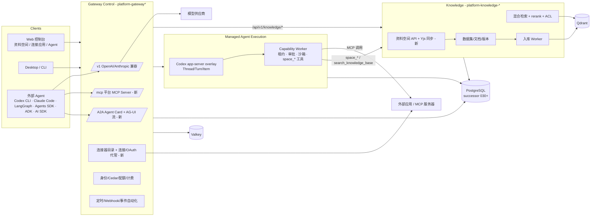

# AgentForge dot_1113 PRD：企业内部全能平台 + 通用 Agent + 资料空间

> 状态：草案 v1（2026-11-13，北京时间 11-14 凌晨）｜基线：`main@4451118`｜分支：`dot_1113`
> 定位：产品 + 技术总纲。执行台账仍以 `deploy/runbooks/native-enterprise-upgrade/loop-state.json` 为准（AGENTS.md 规则），本文不另起状态权威。
> 原则：**Agent first**（AI 通过 skills / MCP / 插件 / 连接器 / 资料空间完成工作，不做过细的手工功能）；**管线真实、数据可模拟**；不新增常驻服务（ADR-008）；平台服务用 Rust，前端 React/TS；上游 Codex 源码不改，集成写在 overlay。

---

## 0. 一页结论

1. **底座强、产品面薄。** 网关（OpenAI 兼容 `/v1/chat/completions|responses|embeddings|messages` 已在 4451118 合入）、持久化 Agent 内核（Codex app-server overlay）、能力租约、计费账本、混合检索 + rerank、评测门禁都已有源码和部分真实证据；但**没有资料空间、没有统一连接器目录、平台自身不对外暴露 MCP Server、SDK 兼容是 Rust 仿写而非官方 SDK**。
2. **4451118 当前不能整体编译。** 本地基线（`/workspace/af/logs/cargo-check-workspace-head.log`）显示 `platform-local-node`（模块重复定义）、`platform-auth`（`ApplicationPrincipal::GatewayLocalNode` 未覆盖等）、`platform-knowledge-domain`、`platform-migration-authority`（lib test）、`platform-tools` 编译失败；web `type-check`（`QATab.tsx` unknown error）、`build`（`PUT /api/v1/knowledge/@/documents/@/content` 未入 OpenAPI 合同）、`test`（`sse.test.ts`）失败。**M0 第一件事是把基线修绿**，否则云端 Agent 无法证明任何改动。
3. 本期新增五个产品支柱：**资料空间**（Notion 式，核心）、**连接器目录**（参考"连接应用"弹窗截图（该图未落到我这台机器，按描述实现），MCP/OAuth/技能/插件同一目录）、**Codex harness 兼容追踪**、**Agent SDK 适配**、**前端全面现代化 + 性能**（Modern Web Guidance）。
4. 交付节奏：大里程碑、每个里程碑一个 squash 提交进 `dot_1113`；M0（恢复绿色基线）阻塞一切，之后 M1→M2 串行，M3/M4 可并行，M5 收尾。

---

## 1. 愿景与范围

**愿景**：企业员工在一个平台里完成"找资料—写文档—让 AI 干活—接入业务系统—自动化—度量质量"。顶级通用 Agent（Codex 内核）通过技能、MCP、插件、连接器触达公司所有系统；垂直 Agent 用任何主流框架（LangGraph、OpenAI Agents SDK、Claude Agent SDK、ADK、Vercel AI SDK）构建，通过标准协议接入平台；资料空间是人和 Agent 共用的知识底座，并自动进入 RAG。

**范围内**：资料空间；连接器目录；通用 Agent 的 skills/MCP/plugins 兼容；平台 MCP Server；SDK/协议适配（OpenAI 兼容、AG-UI、A2A）；RAG 接入空间；Agent 评测扩展；自动化（定时、Webhook、事件触发）；前端现代化与性能；各服务模块性能优化。

**范围外（本期）**：自研 CRDT；自研工作流画布（n8n 级可视化编排推到 M5+）；多区域 HA；移动端原生 App；对外 SaaS 计费；GPL 依赖（BlockNote `xl-*` 包不得引入）。

## 2. 用户画像

| 角色 | 典型任务 | 关键诉求 |
| --- | --- | --- |
| 普通员工 | 写周报/方案、查制度、让 Agent 总结和起草 | 像 Notion 一样好用；一键让 AI 读写空间 |
| 团队负责人 | 建团队空间、共享资料、给 Agent 配技能和连接器 | 权限清晰、可共享、可审计 |
| 平台管理员 | 接入 SSO、管理连接器/MCP/插件、配额与模型 | 统一目录、共享连接、OAuth 不泄露令牌 |
| 开发者 | 用 LangGraph/Agents SDK 写垂直 Agent，调平台模型、知识和工具 | OpenAI 兼容端点、MCP Server、A2A、SDK 示例 |
| AI 自身（Agent） | 搜索/读取/创建空间页面，调用连接器 | 稳定的 MCP 工具、ACL 正确、结果可引用 |

## 3. 现状成熟度（源码 + 证据，4451118）

评分：0 无｜1 原型｜2 源码有、未联调｜3 有真实证据但不完整｜4 可用｜5 生产验收。

| 支柱 | 分 | 现状 | 关键路径 |
| --- | --- | --- | --- |
| 网关/模型平面 | 3 | OpenAI 兼容 chat/responses/embeddings/messages/models 已合入（`invocation_http/openai_compat.rs` 1972 行）；准入、配额、计费账本强；官方 openai-node 7.34 跑通 models/chat/stream，embeddings 末次 502 | `rust/platform-native/crates/platform-gateway-foundation/src/invocation_http/`、`reports/native-current-acceptance-20261016/openai-official-sdk-real.json` |
| RAG/知识 | 3 | 数据集/文档/分段/版本、text 文档 + 源替换、dense+BM25+RRF、qwen3-rerank 真实通过、Confluence 同步、Cedar 数据集策略 | `platform-knowledge-domain/src/migration_knowledge_{ingest,query}`、`platform-knowledge-service/src/{http,native_rerank}.rs` |
| 资料空间 | 0 | 无。仅有知识库文本文档编辑（textarea 级）与版本恢复 | `web/src/pages/knowledge/` |
| Agent 评测 | 3 | `platform-eval`（recall@k/MRR/nDCG、trajectory 金标、LLM judge）、`platform-gateway-eval`、前端评测页 | `crates/platform-eval`、`web/src/pages/eval` |
| 自动化 | 2 | 一次性/固定间隔定时任务 + 通知（epoch 011/013/020）；无 cron、Webhook、事件触发、可视化流 | `docs/architecture/gateway-scheduled-tasks.md`、`/api/v1/scheduled-tasks` |
| 通用 Agent / Codex harness | 3 | 单内核 Codex app-server overlay（上游 `openai/codex@69231e1`），持久事件、审批回执、能力租约、Python 沙箱 seccomp；浏览器两轮记忆未最终验收 | `rust/agent-runtime-overlay/kernel-rs/`、`deploy/agent-runtime-source/lock.json` |
| Skills | 2 | `/api/v1/skills` 上传/启停/测试；仓库插件含 SKILL.md；插件包只允许绑定已编译能力，Markdown 技能"惰性"未进内核 | `docs/design/native-plugin-packs.md`、`agent-plugins/*/skills` |
| MCP | 2 | 客户端侧：注册表、发现、只读调用代理，双版本 `2025-11-25`/`2026-07-28`（受限切片，未对真实服务器验收）；**平台不作为 MCP Server 暴露** | `platform-gateway-foundation/src/mcp_registry_api.rs`、`docs/design/mcp-multi-revision.md` |
| 插件 | 2 | Agent Plugins 1.0 `plugin.json`、签名 pack-v2、生命周期 API/UI；不兼容 `.codex-plugin`/Claude Code 插件结构 | `crates/platform-agent-plugins`、`agent-plugins/` |
| 连接器 | 1 | 管理员级 connector config（`/api/v1/connectors/admin/configs`）+ Confluence；无目录、无个人/共享连接、无 OAuth 连接流 UI | `web/src/api/connectors.ts`、`pages/settings/ConnectorsSettings.tsx` |
| 垂直 Agent / SDK 兼容 | 1.5 | `openai_agents`/`claude_agent_sdk` 适配器为 **Rust 原生仿写**（文档明确"不代表官方 SDK 兼容"）；无 LangGraph/ADK/AI SDK 运行时、无 AG-UI/A2A 端点 | `docs/architecture/native-sdk-agent-frameworks.md`、`crates/platform-sdk-agent-worker` |
| Web 控制台 | 2.5 | React 19.2 + Vite 8 + TS 6 + antd 6 + Tailwind 4 + TanStack Query 5 + zustand 5；antd/Radix 双体系；当前 type-check/build/test 失败；opensource e2e 57 通过但 a11y 有失败 | `web/package.json`、`/workspace/af/logs/web/` |
| 身份/租户 | 3 | 企业 OIDC、SCIM 2、Passkey、step-up、Cedar；JWT 已有 Ed25519 轮换夹具；RLS 定义未激活 | `crates/platform-auth/src/enterprise/` |
| 可观测/性能 | 2.5 | OTel trace、`/metrics` 认证抓取有证据；gateway/runtime 强制单实例；bundle 预算脚本 | `crates/platform-tools/src/guard.rs`、`web/scripts/check-bundle-budget.mjs` |

**技术栈版本**：Rust 1.99.0（native）/ 1.95.0（runtime overlay）、axum 0.8、sqlx 0.8、tokio 1、cedar-policy 4.14、reqwest 0.13.5；Node 26.11.1、pnpm 12.11.2；PostgreSQL 16（冻结基线 `2026_08_post_kb_v1` + canonical successor 001–029）、Redis/Valkey、Qdrant。**Python**：`src/`、`packages/` 已无 `.py`，只保留可选 Python 用户代码沙箱（Capability Worker）和少量脚本。

**4451118 合并确立的模块边界**（必须遵守）：三个业务上下文 Gateway Control / Managed Agent Execution / Knowledge；Gateway 不持有 KB 表（`make gateway-kb-boundary-gate`）；数据库结构只经 `database-authority` + successor 链变更；Runtime/Worker 走受控 overlay 与 manifest 哈希；前端只调用 `sdk/typescript/generated.ts` 中已发布的操作（`web/scripts/check-api-contract.mjs`）。

## 4. 支柱规格

### 4.1 资料空间（核心）

**信息架构（对齐参考截图）**
- 左栏：全部｜页面｜幻灯片｜站点｜图像｜Google Drive（外部来源，经连接器）｜最近（最近打开 5 条）｜空间列表（命名空间，可折叠，带图标）｜回收站。
- 主区：标题"资料空间"；Tab：推荐｜收藏｜你的条目｜与你共享；搜索框；"创建"下拉（页面、空间、上传文件、导入 md/html/docx/zip、从模板）；列表/网格切换；列：名称（类型图标 + 标题 + 所属空间徽标）｜来源（你/共享人/连接器）｜上次活动（相对时间）；行内操作：收藏、分享、移动、重命名、删除。
- 页面视图：面包屑 + 页面树侧栏（拖拽排序/嵌套）+ 块编辑器 + 右侧面板（AI 助手、评论、版本、反向链接）。

**数据模型（Knowledge 上下文，新 schema successor 030，表在 `knowledge` schema）**
- `spaces(space_id, tenant_id, name, icon, kind[personal|team|tenant], visibility[private|members|tenant], dataset_id → knowledge.datasets, created_by, created_at, updated_at, archived_at)`；每个空间绑定一个隐式知识数据集，复用现有入库/检索/ACL。
- `space_items(item_id, tenant_id, space_id, parent_id, kind[page|folder|file|link|slide|site|image|external], title, icon, position(text, fractional index), source[native|upload|connector:<id>], external_ref jsonb, document_id → knowledge.documents NULL, content_format[blocknote_json|markdown|binary], current_revision, created_by, updated_by, created_at, updated_at, last_activity_at, deleted_at)`。
- `space_item_revisions(item_id, revision, blocks jsonb, markdown text, content_sha256, author, created_at)`：每次保存一条（M1 加 Yjs 快照 `ydoc_state bytea` 与增量合并）。
- `space_members(space_id, principal_type[user|group|role], principal_id, role[owner|editor|commenter|viewer])`；`space_item_shares(item_id, principal…, role)` 用于单条共享（"与你共享"）。
- `space_item_stars(user_id, item_id)`、`space_item_activity(item_id, user_id, action, at)`（驱动"推荐/最近/上次活动"）。
- 原则：块 JSON 是真源，markdown 是派生投影（用于 RAG、导出、Agent 读取）；软删除进回收站，30 天后清理任务（复用定时任务）。

**编辑器选择：BlockNote 0.57（MPL-2.0，基于 Tiptap 3 / ProseMirror）**
- 理由：开箱即 Notion 体验（slash 菜单、拖拽手柄、嵌套块、toggle、表格），Yjs 协作与评论免费，内置 24 种语言含中文，版本侧栏；底层是 Tiptap 3.34 / ProseMirror，可下沉自定义。React 19 peer 已支持。
- 约束：**禁止** `@blocknote/xl-*`（GPL-3.0/商业）；DOCX/PDF 导出改用服务端（Rust）或 MIT 库实现；UI 选 `@blocknote/shadcn` 或 `@blocknote/mantine` 二选一，优先与控制台统一的样式体系，按路由懒加载。
- 备选：Tiptap 3 自建（控制力最高、成本最大）；Plate（MIT，扁平缩进模型不利树导出）；Lexical（UI 全自建）；AFFiNE/BlockSuite（整体过重）。

**协作**：M0 单人编辑 + 自动保存（`If-Match` 乐观并发，冲突提示）；M1 引入 Yjs：服务端在 Knowledge API 进程内用 Rust `yrs 0.28` 实现 Hocuspocus/y-websocket 兼容的同步与 awareness（参考 hocuspocu-rs 的线协议兼容思路，不新增服务），持久化为 `ydoc_state` + 去抖快照，客户端 `@hocuspocus/provider 4.x`。Loro 性能更好但生态与 BlockNote 绑定弱，暂不选。

**权限与共享**：空间角色 owner/editor/commenter/viewer；条目可单独分享给用户/组；租户隔离沿用 ADR-010；检查在 Knowledge 服务内统一 `authorize(principal, item, action)`，复用现有 Cedar 数据集策略，空间 ACL 同步为数据集/文档 ACL，**检索时按调用者身份过滤**（Agent 代表用户调用时用用户身份，不用服务身份）。

**搜索**：列表搜索走 PG（标题 + `tsvector`/trigram）；全文 + 语义走现有混合检索（dense + BM25 + RRF + 可选 rerank），结果回到条目粒度并带高亮片段。

**导入/导出**：导入 md/html（M0 md，M1 html/docx/zip）；导出 md/html（M1），PDF/DOCX（M2，服务端渲染）。上传文件（pdf/zip/图片）以 `file` 条目存在，内容走现有上传入库。

**RAG 接入**：保存页面 → 生成 markdown 投影 → 调用知识服务现有"文本文档创建/源替换"路径写入空间数据集（版本化、增量重建分段与向量，按内容哈希跳过无变化保存，去抖 ≥5s）；删除/移入回收站 → 文档归档；权限变化 → 文档 ACL 更新。检索结果携带 `space_id/item_id/revision` 便于引用跳转。

**AI 与 Agent 操作**
- 编辑器内：选中改写/续写/总结/翻译、"问这个空间"，全部走平台网关模型（OpenAI 兼容端点），不直连供应商。
- Agent 工具（同时以内核能力和平台 MCP Server 暴露）：`space_list`、`space_search`（ACL 过滤）、`space_read_page`（返回 markdown + 块 ID）、`space_create_page`、`space_append_blocks`、`space_update_page`（写操作走现有审批/租约，默认需确认）。配套技能 `space-writer`（SKILL.md：何时建页、如何组织结构、引用规范）。

**验收**：见 §8 里程碑。

### 4.2 连接器目录（对齐"连接应用"参考弹窗）

- **入口**：全局"连接应用"弹窗 + 设置页。顶部搜索"搜索应用和技能"；分类 chip：全部｜本机（Local Node）｜办公协作｜沟通｜设计｜开发｜数据｜密码管理｜更多；"已连接 N" 指示 + 已连接图标；"Bot 模板"链接；"为你推荐"网格（图标、名称、一句话描述、连接按钮）；"这台电脑"分组（通过 Local Node 的本地集成：文件、日历、提醒、通讯录等，按平台显示）。
- **目录模型（registry）**：一个条目 = `catalog_entry {id, kind[connector|mcp_server|skill|plugin|bot_template], display, icon, categories, publisher, auth[oauth2|api_key|pat|none|local_node], scopes(read/write 分级), mcp {transport, url, protocol_versions}, skills[], plugin_ref, availability(tenant policy), trust(signature/sha)}`。来源：内置清单（仓库 `config/catalog/*.json`）+ 租户私有条目 + 可选同步官方 MCP Registry（`server.json`）。技能和插件进同一个可搜索目录。
- **连接流**：OAuth 2.1 + PKCE（授权码在 Gateway 完成，令牌加密存于凭据代管，**不进浏览器、模型、日志**）；支持 MCP 授权：Protected Resource Metadata 发现、RFC 9207 issuer 校验、优先 CIMD（客户端元数据文档）其次 DCR、resource indicator；企业场景支持 MCP Enterprise-Managed Authorization（ID-JAG，IdP 统一授权）。API key/PAT 走加密表单。
- **个人 vs 共享连接**：`connection {owner: user|tenant|space, catalog_entry, credential_ref, scopes, status}`；共享连接由管理员绑定服务账号，成员按策略使用（只读默认），审计记录"谁借用共享连接做了什么"。
- **状态**：`available → connecting → connected | needs_reauth | error | disabled_by_policy | revoked`；UI 显示加载转圈、错误原因与重连。
- **与 Agent 打通**：连接成功即把对应 MCP 工具/技能注册到通用 Agent 的工具搜索（`tool_search`/`tool_describe`/`tool_call`），按用户连接解析凭据；写操作沿用审批。

### 4.3 通用 Agent（Codex harness + skills/MCP/plugins）

- **Codex harness 兼容追踪**：对齐上游 app-server v2 协议（Thread/Turn/Item；`thread/start|resume|fork`、`turn/start|steer|interrupt`、`item/*` 增量、服务端审批请求）。建立"上游版本 → overlay 改动 → schema 哈希"的升级流水：每次升级跑 `make agent-runtime-source-contract`、`agent-runtime-single-kernel-gate`、app-server schema diff 报告；`docs/harness/codex-upstream-upgrade.md` 为流程权威。
- **Skills**：完全遵循 agentskills.io 规范（`name`/`description`/`license`/`compatibility`/`metadata`/`allowed-tools`，三级渐进加载）；技能可来自目录、插件或空间（空间里的"技能页"可发布为 SKILL.md）；内核在会话开始只注入名称+描述。
- **MCP**：客户端侧把现有受限双版本切片补齐到对真实参考服务器验收（2026-07-28 无状态核心、`server/discover`、`Mcp-Method/Mcp-Name` 头、MRTR、列表缓存提示；兼容 2025-11-25）；**新增平台 MCP Server**：Gateway 暴露 `/mcp`（Streamable HTTP，无状态，OAuth 受保护资源），工具首批为资料空间与知识检索，供 Codex CLI、Claude Code、Cursor 及垂直 Agent 使用。
- **插件**：在现有 Agent Plugins 1.0 之上兼容读取 `.codex-plugin/plugin.json`、Claude Code `.claude-plugin/plugin.json`、`.agents/plugins/marketplace.json`；插件可携带 skills、`.mcp.json`、agents、commands、hooks；可执行部分仍只能绑定已签名、已编译能力（安全红线不变）。
- **A2A**：Gateway 为已发布 Agent 暴露 Agent Card（`/.well-known/agent-card.json`，A2A 1.0），支持 send/stream/get task；也可作为客户端调用外部 A2A Agent（作为工具）。
- **沙箱代码执行**：沿用 Capability Worker Python 沙箱（seccomp）；stdio MCP 只能在 Worker 沙箱内运行。

### 4.4 垂直 Agent 与 SDK 适配

- **原则**：平台不内嵌每个框架，而是提供"标准插座"，任何框架写的 Agent 都能接：
  1. **模型插座**：OpenAI 兼容 Chat Completions / Responses / Embeddings 与 Anthropic Messages（已有），带虚拟密钥、模型白名单、预算。
  2. **工具/知识插座**：平台 MCP Server（空间、知识、连接器工具）。
  3. **UI 插座**：AG-UI 1.0 事件流适配（平台 Thread/Turn/Item → AG-UI 事件），以及 Vercel AI SDK UI Message Stream 适配，便于前端直接 `useChat`。
  4. **Agent 互联插座**：A2A 1.0。
  5. **托管运行**：垂直 Agent 以容器镜像注册为"外部服务"（现有 service-registrations），Gateway 负责身份、配额、审计；官方 SDK 代码作为用户代码运行，不进入平台服务进程。
- **示例与模板（`examples/vertical-agents/`）**：LangGraph/LangChain 1.x `create_agent`（Python）、OpenAI Agents SDK（TS 0.22）、Claude Agent SDK（TS）、Google ADK（TS 2.5 / Python）、Vercel AI SDK（`ai` 7.x）各一个最小可跑示例，全部只配置 `base_url` 指向网关 + 平台 MCP Server。
- **现有 Rust `openai_agents`/`claude_agent_sdk` 适配器**：保留，更名为"原生快速路径"，文档说明不等于官方 SDK。

### 4.5 企业 RAG

- 混合检索（dense + BM25 + RRF）为默认，**rerank 默认开启**（qwen3-rerank / 本地 cross-encoder 回退），有界候选与阈值；按用户身份 ACL 过滤在召回前进行（预过滤）而非仅后过滤。
- 连接器即数据源：Confluence 已有，新增 Google Drive / 飞书文档 / GitLab Wiki 只读同步（M2+），统一走连接器凭据与 ACL 映射。
- 资料空间为一等数据源（§4.1）；增量索引、内容哈希去重、蓝绿 embedding 迁移已有可复用。

### 4.6 Agent 评测

- 复用 `platform-eval`：检索指标门禁 + trajectory 金标 + LLM-as-judge（裁判模型与被测模型分离）。
- 新增：空间工具与连接器工具的 trajectory 用例（禁止越权、引用正确、写操作需审批）；按 OTel GenAI agent span 语义记录轨迹；评测作为里程碑回归门禁（离线 fixture，无需真实供应商），真实模型评测作为可选 nightly。

### 4.7 自动化

- 现有：一次性/固定间隔定时任务。补齐：cron 表达式与时区、Webhook 触发（签名校验）、事件触发（空间页面变更、连接器事件）、动作 = 运行 Agent/技能/写空间/发通知。
- 持久性：沿用 Gateway 定时任务的 PG 执行回执与租约（不引入 Temporal 等新服务；设计借鉴其"每步结果入历史、重放不重复副作用"）。可视化编排推后，先做"自然语言创建自动化"（Agent first）。

### 4.8 前端现代化与性能

- **Modern Web Guidance（GoogleChrome，Apache-2.0）**：`npx modern-web-guidance@latest install` 会把技能装到项目 `.agents/skills/modern-web-guidance`（约 210 个指南文件、2.4 MB，Codex/Cursor/Claude 等通用读取；`.agents/` 已在 `.gitignore`）。CLI：`search "<2–5 词能力>"`、`retrieve <id>`、`legacy-scan <path> --json`。对 `web/src` 试跑 `legacy-scan`：8 条发现（`ime-safe-enter-submit` ×6、`autofill-sign-in-form` ×1、`form-fields-automatically-fit-contents` ×1）。所有前端工作：先 `search`→`retrieve`，再写代码；结束前 `legacy-scan` 不新增发现；设置 `DISABLE_TELEMETRY=1`。
- 现代平台能力优先：原生 `<dialog>`/Popover/`closedby` 轻关闭、View Transitions、`content-visibility` 延迟渲染长列表、容器查询、`fetchpriority`、`loading=lazy`、IME 安全回车提交。
- 统一 UI 体系：逐步收敛 antd 6 + Radix 双体系（新页面不再引入第三套）；路由级代码分割，编辑器包单独 chunk；bundle 预算脚本门禁；Core Web Vitals（LCP < 2.5s、INP < 200ms、CLS < 0.1）在 Playwright 中度量；WCAG 2.2 AA（现有 a11y spec 修绿）。
- impeccable 设计技能（`skills-lock.json` 已锁定）继续作为视觉/交互评审工具。

### 4.9 性能与各服务模块优化

- Gateway：热路径零拷贝流式转发、连接池复用、`/v1/*` p95 额外延迟 < 15 ms（不含上游）；Redis 准入 Lua 批量化；去掉单实例硬约束的前置条件梳理（HA 设计，不在本期实施）。
- Knowledge：入库并发与批量 embedding、空间保存去抖与哈希跳过、检索 p95 < 300 ms（不含 rerank）、rerank 候选上限。
- Runtime/Worker：事件扇出背压、冷启动时间、沙箱池预热。
- 前端：首屏 JS ≤ 现预算、空间列表 1 万条虚拟化/`content-visibility` 流畅。
- 方法：每个模块先测量（criterion 基准 / k6 或 oha 压测 / Playwright trace），再优化，报告写入 `reports/`。

## 5. 横切关注

- **认证/SSO/RBAC/租户**：沿用企业 OIDC、SCIM、Passkey、Cedar；新增权限点 `knowledge:space:{view,create,edit,share,admin}`、`connector:{view,connect,share,admin}`；RLS 激活按 loop-state U-DATA-04 推进，不在本期强行开启。
- **审计**：空间分享/权限变更/删除、连接器连接/借用、Agent 写操作全部入审计事件。
- **可观测**：新接口全部有 trace + RED 指标；Agent 轨迹用 OTel GenAI 语义。
- **安全**：令牌只在服务端；连接器 OAuth state/PKCE；SSRF 防护沿用 MCP 公网地址 DNS pin；编辑器内容 HTML 导出走 DOMPurify；文件上传类型与大小白名单；GPL 依赖禁入（CI license 检查）。
- **成本**：空间索引去抖+哈希跳过；AI 编辑功能走网关计费与预算；评测默认离线 fixture。

## 6. 目标架构

边界说明：资料空间属于 Knowledge 上下文（API 路径 `/api/v1/knowledge/spaces/...`，经 Gateway 现有知识代理转发，不违反 `gateway-kb-boundary-gate`）；平台 MCP Server、连接器目录、A2A/AG-UI 属于 Gateway Control；空间 Agent 工具属于 Capability Worker 能力目录。不新增常驻服务。

## 7. 今晚做不到的（诚实说明）

- 生产级多人实时协作的压测与 HA；Yjs 服务端仅在 M1 做到单实例可用。
- 连接器真实 OAuth 需要各家开发者应用（client id/secret）和用户授权，今晚只能用 mock 授权服务器 + 1 个真实可用的（如 GitHub/Notion 若有凭据）。
- 官方 SDK 示例的真实模型运行依赖网关可用的模型 key（阿里云新加坡 key 已在主代理处，按预算使用）。
- 新 successor 030 需要隔离 PG16 测量回执；若云端 Agent 环境无 PG，由本地验收补测（我在本机有 Docker）。
- RLS 激活、多实例 HA、合规文档不在本期。
- 基线修复范围取决于编译错误数量；若某 crate 修复需要业务语义决策，会标记并跳过而不是猜。

## 8. 里程碑与验收（详见 PLAN.md）

| 里程碑 | 内容 | 核心验收 |
| --- | --- | --- |
| M0 | 恢复绿色基线（编译、锁文件、前端半合并、CI 诚实化、原生启动冒烟）+ PRD/PLAN 入库 | workspace `cargo check --all-targets` 绿；web type-check/lint/test/build/e2e 绿；`native-smoke.sh` READY + LOGIN_OK |
| M1 | 资料空间后端（successor 030、API、权限、OpenAPI）+ 前端外壳与列表页（对齐截图） | 空间 API 连 PG 集成测试；`/spaces` e2e + a11y；真实服务 curl 冒烟 |
| M2 | BlockNote 编辑器 + 页面树 + 自动保存/版本 + RAG 增量索引 + Yjs 协作 + md/html 导入导出 | 写入短语可被检索召回且 ACL 正确；双浏览器协同一致；无 GPL 依赖 |
| M3 | 连接器目录 + 连接/OAuth 流 + 平台 MCP Server + skills/插件兼容 | "连接应用"弹窗 e2e；mock OAuth 端到端仅存密文；MCP 客户端两种协议版本调用 `space_search` |
| M4 | Codex harness 升级追踪 + AG-UI/A2A/AI SDK 适配 + 5 个垂直 Agent 示例 + 评测用例 | app-server schema diff 报告；示例 mock 全绿、LIVE 抽测；A2A card 校验 |
| M5 | 前端全面现代化（MWG）+ 各服务性能优化 + 自动化补齐（cron/Webhook/事件） | `legacy-scan` 归零或有理由保留；CWV 达标；性能报告前后对比；Webhook 端到端 |

## 附录 A：参考来源（2026-11-13 检索）

- MCP 2026-07-28 规范发布：https://blog.modelcontextprotocol.io/posts/2026-07-28/ ；Discovery：https://modelcontextprotocol.io/specification/2026-07-28/server/discover ；变更日志：https://github.com/modelcontextprotocol/modelcontextprotocol/blob/main/docs/specification/2026-07-28/changelog.mdx ；TS SDK 迁移：https://github.com/modelcontextprotocol/typescript-sdk/blob/main/docs/migration/support-2026-07-28.md
- MCP Registry：https://modelcontextprotocol.io/registry/about ；API：https://github.com/modelcontextprotocol/registry/blob/main/docs/reference/api/official-registry-api.md
- MCP Enterprise-Managed Authorization：https://modelcontextprotocol.io/extensions/auth/enterprise-managed-authorization ；连接器认证（CIMD/DCR）：https://claude.com/docs/connectors/building/authentication
- Codex App Server：https://learn.chatgpt.com/docs/app-server ；设计文章：https://openai.com/index/unlocking-the-codex-harness/ ；README：https://github.com/openai/codex/blob/main/codex-rs/app-server/README.md
- Codex/Agent 插件格式：https://developers.openai.com/plugins/build/plugins ；https://github.com/openai/plugins
- Agent Skills 规范：https://agentskills.io/specification ；最佳实践：https://agentskills.io/skill-creation/best-practices
- A2A 1.0：https://a2a-protocol.org/latest/specification/ ；变更：https://a2a-protocol.org/latest/whats-new-v1/
- AG-UI 1.0：https://docs.ag-ui.com/spec/1.0 ；https://www.copilotkit.ai/blog/ag-ui-1.0
- Vercel AI SDK UI Message Stream：https://ai-sdk.dev/v6/docs/ai-sdk-ui/stream-protocol
- LangChain v1 / LangGraph v1：https://docs.langchain.com/oss/python/releases/langchain-v1 ；https://docs.langchain.com/oss/python/migrate/langgraph-v1
- 框架对比（ADK/LangGraph/Agents SDK）：https://www.honeyhive.ai/learn/google-adk-vs-langgraph-vs-openai-agents-sdk
- 编辑器对比：https://domternal.dev/blog/best-notion-style-editors/ ；https://amineseboui.github.io/quoin-editor/comparison/ ；BlockNote 发布：https://github.com/TypeCellOS/BlockNote/releases ；Tiptap 发布：https://github.com/ueberdosis/tiptap/releases
- CRDT：https://www.pkgpulse.com/guides/yjs-vs-automerge-vs-loro-crdt-libraries-2026 ；Loro 协议：https://loro.dev/blog/loro-protocol ；Rust Hocuspocus 兼容实现：https://github.com/yangbooom/hocuspocu-rs
- 企业 RAG ACL/混合检索：https://quellixlabs.com/insights/permission-aware-ai-search-enterprise-rag-security ；https://oneliners.guru/guides/hybrid-retrieval-bm25-vectors-fusion-reranking-acl
- Agent 评测与 OTel GenAI agent spans：https://github.com/open-telemetry/semantic-conventions-genai/blob/main/docs/gen-ai/gen-ai-agent-spans.md ；https://iotdigitaltwinplm.com/ai-agent-trajectory-evaluation-patterns-2026/
- 持久执行：https://cadenya.com/other-content/durable-execution-for-ai-agents ；https://www.zymr.com/blog/temporal-vs-n8n
- Modern Web Guidance：https://developer.chrome.com/docs/modern-web-guidance ；https://github.com/GoogleChrome/modern-web-guidance-src

## 附录 B：已核实的包版本（npm/crates，2026-11-13）

`@blocknote/{core,react,shadcn,mantine}` 0.57.0（MPL-2.0）｜`@tiptap/core` 3.34.0｜`yjs` 13.6.33｜`y-prosemirror` 1.3.7｜`@hocuspocus/provider` 4.8.0｜`@modelcontextprotocol/sdk` 1.32.2、`@modelcontextprotocol/server` 2.4.0｜`@ag-ui/core` 1.0.4｜`@a2a-js/sdk` 1.3.0｜`ai` 7.0.172｜`@openai/agents` 0.22.0｜`@anthropic-ai/claude-agent-sdk` 0.3.323｜`langchain` 1.6.5、`@langchain/langgraph` 1.7.4｜`@google/adk` 2.5.0｜crates：`yrs` 0.28.1、`rmcp` 3.10.0｜`modern-web-guidance` 1.0.0（skill-version 2026_11_09）。
