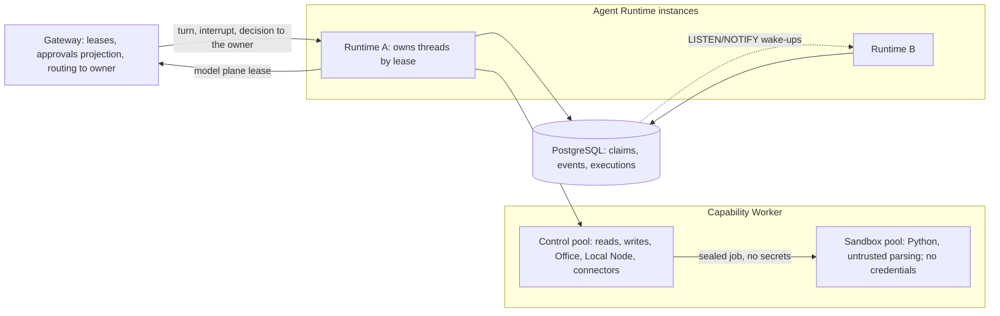

# 03 Agent execution (Agent Runtime, Capability Worker, SDK Agent Worker)

status: proposed · domain_id: platform-upgrade-2026-10 · last_verified: 2026-10-16 (HEAD `22d9ce0`)

## 1. Role

The agent-execution context runs agents and executes their actions under the Gateway's authority.

- **Agent Runtime.** The only managed kernel. It owns model and tool iteration, compaction,
  cancellation state, approval transitions and event ordering (platform law L5).
- **Capability Worker.** Executes leased capabilities (reads, governed writes, Office artifacts,
  Python, attachments, Local Node calls) with fences and unknown-effect semantics.
- **SDK Agent Worker** (optional, ADR-012). A private worker for SDK-protocol runs with its own
  native engine. It is not a second managed kernel.

## 2. Current architecture (SRC)

### 2.1 Agent Runtime

| Aspect | Current state |
| --- | --- |
| Composition | Platform crate `ai-platform-agent-runtime` (16.8k lines) composed over OpenAI Codex `rust-v0.162.1` (`092d3acd`). The [overlay manifest](../../../rust/agent-runtime-overlay/manifest.json) lists 148 files: 111 platform-owned and 37 modified upstream files in `app-server`, `core` (session, turn, compaction, tools), `ext`, `protocol` and `tools`. Built with the upstream toolchain, Rust 1.95.0. |
| Kernel | The Codex App Server runs in process (`AgentKernel::start`). The upstream bundled model catalog is written with `use_responses_lite=false`. The per-home SQLite state DB is disabled because it would mix tenants ([main.rs:110, :145](../../../rust/agent-runtime-overlay/kernel-rs/ai-platform-agent-runtime/src/main.rs)). Code Mode, hooks, Apps, plugins, Guardian automation and realtime are not enabled ([COMPATIBILITY.md](../../../rust/agent-runtime-overlay/kernel-rs/ai-platform-agent-runtime/COMPATIBILITY.md)). |
| Private API | `/internal/v1/threads`, turns, recover, interrupt, resume, archive, approvals, SDK capabilities and SSE events. Authenticated with a static internal token plus tenant, user and session headers ([http_service.rs](../../../rust/agent-runtime-overlay/kernel-rs/ai-platform-agent-runtime/src/http_service.rs)). |
| Persistence | `PostgresThreadStore`: thread membership, native `RolloutItemWire` history, projections and a sequenced V1 event log. Commits are synchronous, and a failed write poisons the thread in that process. |
| Execution ownership | A renewable per-run claim in `assistant_runtime_execution_owners` (instance ID, monotonically increasing fence, 30 s lease and heartbeat). It is checked on every model call, tool dispatch, rollout write and terminal projection. A recovery loop claims expired runs every 5 s or on notify ([execution.rs:87](../../../rust/agent-runtime-overlay/kernel-rs/ai-platform-agent-runtime/src/postgres_store/execution.rs), [recovery.rs:207](../../../rust/agent-runtime-overlay/kernel-rs/ai-platform-agent-runtime/src/http_service/recovery.rs), [durable recovery design](../../design/agent-runtime-durable-recovery.md)). |
| Process-local state | One event broadcast channel (capacity 256), an approval broker with waiters (decisions are durable), per-turn cancellation tokens, read-only turn bindings (900 s TTL, 1,024 entries), per-thread gates and the set of recovering threads ([http_service.rs:61–75](../../../rust/agent-runtime-overlay/kernel-rs/ai-platform-agent-runtime/src/http_service.rs)). |
| Events | SSE replays the durable backlog, then follows the broadcast channel. Every subscriber also re-reads PostgreSQL every 500 ms (F-35). |
| Model plane | Responses wire to the Gateway's private model plane under turn-scoped signed leases; `traceparent`, `tracestate` and request ID travel in model metadata and on internal hops ([trace_context.rs](../../../rust/agent-runtime-overlay/kernel-rs/ai-platform-agent-runtime/src/trace_context.rs)). |
| Tools | With the Worker enabled, every dynamic capability call (reads included) goes to the Capability Worker with a per-call lease the Runtime mints (Capability Contract V2); writes first need an approval. Without the Worker, reads fall back inline to the Gateway capability plane and writes fail closed ([capability_dispatch.rs:403–647](../../../rust/agent-runtime-overlay/kernel-rs/ai-platform-agent-runtime/src/http_service/capability_dispatch.rs), [capability_execution.rs:248](../../../rust/agent-runtime-overlay/kernel-rs/ai-platform-agent-runtime/src/capability_execution.rs)). |
| Telemetry | `tracing_subscriber::fmt` only. The platform crates have no OpenTelemetry exporter. |
| Image | The final stage is the full `rust:1.95.0-bookworm` toolchain image ([Dockerfile.runtime:79](../../../deploy/agent-runtime-source/Dockerfile.runtime)). Compose defaults to images built from the previous upstream revision `94cbbdda` (F-02). |

### 2.2 Capability Worker

| Aspect | Current state |
| --- | --- |
| Crates | `ai-platform-capability-worker` (16.3k lines), `ai-platform-capability-contract` (Capability Contract V2 descriptors and canonical hashes, 1.7k), `ai-platform-office` (Typst-based Office rendering, 2.4k) |
| Executors | Reads (file system, web, working memory, proofs, Knowledge), writes, external writes (Confluence broker), Office artifacts, Python, attachments, Local Node broker, quiz persistence. Plugin packs bind already-compiled capabilities by pinned digest ([native plugin packs](../../design/native-plugin-packs.md)). |
| Lifecycle | PostgreSQL execution records, a dispatch fence per execution, terminal checks before dispatch, cancellation and restart recovery. Unknown writes are never replayed. |
| Concurrency | **One process-wide execution slot** for all tenants and capability kinds (F-34) |
| Python sandbox | `unshare` user/net/mount/pid namespaces, cleared environment, `setsid` and parent-death signal, rlimits (CPU, address space, RSS, file size, processes), dropped capabilities, `no_new_privs`, a hand-written default-allow seccomp denylist, a static module and builtin denylist, 300 s and 24 MiB caps. The container needs `seccomp=unconfined` (F-06). Image base is `python:3.11-slim-bookworm`. |
| Secrets held | Internal token, capability lease signing secret, proof secret ([main.rs:41–56](../../../rust/agent-runtime-overlay/kernel-rs/ai-platform-capability-worker/src/main.rs)) (F-04) |

### 2.3 SDK Agent Worker

`platform-sdk-agent-worker` (2.8k lines) supervises one `ai-platform-sdk-agent-engine` process per
run. The engine receives `{request, provider_key}` on stdin, emits NDJSON events, and runs native
streamed loops against the OpenAI Responses and Anthropic Messages APIs directly with the provider
key (F-11). Cost is unavailable because direct APIs do not return it. The parent re-checks authority
every ten seconds while a run is active. OpenAI Agents SDK 0.23.1 SQLite sessions import read-only;
opaque Claude resume IDs fail closed
([engine COMPATIBILITY.md](../../../rust/agent-runtime-overlay/kernel-rs/ai-platform-sdk-agent-engine/COMPATIBILITY.md)).
The worker owns one private state volume with file-system session locks and is not replicated
([architecture.md](../../harness/architecture.md)).

## 3. Assessment

Strengths to keep: one kernel whose loop belongs to upstream; synchronous durable persistence with
sticky failure; run claims with fences checked at every side effect; unknown-effect semantics that
never replay uncertain writes; descriptors with schema hashes and immutable thread ceilings; an
isolated agent home; strict input and output caps; bounded trace-context validation.

Gaps, in order of consequence:

1. **Tool capacity (F-34).** One execution slot serializes every tenant's tool calls. A five-minute
   Python run stalls all other agents' reads and writes. This is the cheapest high-value fix in the
   context.
2. **Sandbox strength (F-06).** The design is sound, but the boundary is the shared host kernel
   behind a default-allow filter. The sandbox shares a container with brokers that hold the
   internal token and the lease signing secret, so an escape reaches platform authority.
3. **Upgrade cost of the overlay.** Codex shipped about 16 releases in the 30 days before this
   review (WEB). Each sync must carry 37 modified upstream files through `core/session`,
   `core/tools`, `app-server` and `ext`. History uses the native upstream format, and N-1 decoding
   is unproven: the older `94cbbdda` binary cannot decode newer records.
4. **Single instance (F-10, F-35).** Fences already make a takeover safe, but interrupts, approval
   waiters, cancellation tokens and live fan-out are process-local. A second instance cannot
   serve a thread it does not own, and SSE costs two database reads per subscriber per second.
5. **Trust (F-04).** The Runtime mints per-call capability leases with an HMAC secret that the
   Worker (and Gateway) also hold, so the Worker can mint the leases it verifies, and a leaked
   secret mints leases for any tenant. All hops share one bearer token.
6. **Observability (F-14).** There are no spans from the Runtime or Worker, so time-to-first-token,
   tool latency and approval wait time cannot be attributed per stage.
7. **Images (F-22).** The Runtime ships a compiler toolchain. Both images are on Debian 12, which
   moved to LTS on 2026-07-12. Python 3.11 is security-only.
8. **SDK governance (F-11).** Provider keys leave the Gateway; no receipts, quotas or guardrails
   apply to SDK model calls.

## 4. Target architecture

### 4.1 Runtime: keep the kernel, shrink the seam (U-RT-05, U-RT-07)

- **Upstream stays the only loop.** No platform loop and no second kernel ([ADR-006](../../architecture/ADR-006-agent-runtime-single-kernel.md); vNext DEC-03).
- **Fewer patched upstream files.** Turn each patch into an extension point and propose generic
  hooks upstream: durability marker before model sends, remote thread store, turn suspension, tool
  lifecycle and tool policy contributors. Target: no more than 15 modified upstream files within
  two sync windows (from 37). Report patch size, conflicts and time-to-green for every sync.
- **Sync cadence.** One sync window per month on a stable `rust-v` tag, not every release. Gates:
  App Server schema diff (exists), N-1 history decode corpus, replay of recorded turns against a
  deterministic mock provider, eval smoke set and SBOM diff.
- **History compatibility.** Persisted rollout items carry the upstream revision and schema hash
  that wrote them. A decoder corpus proves the release can read N-1 history before it ships.
  Rollback stays stop-write plus restore until the corpus proves otherwise.

### 4.2 Runtime: multi-instance execution (U-RT-01…04)

Order matters. Stages A and C (terminal vocabulary; atomic owner-fenced terminal commit) come
first, because takeover multiplies any terminal-state bug.

1. **State inventory (U-RT-02).** Declare each process-local item as owner-affine (cancellation
   tokens, approval waiters, read-only bindings, thread gates) or shared. Persist what a takeover
   needs: read-only binding payloads, and cancellation intent as a durable row.
2. **Thread ownership (U-RT-03).** Extend the existing run claims to a thread owner lease carrying
   the owner instance's internal address. The Gateway sends turn starts, interrupts and approval
   decisions to the owner. If the lease has expired, any instance claims it with a higher fence
   and resumes through the existing recovery path. Durable rows stay the truth; the network path
   only speeds things up.
3. **Fan-out (U-RT-04).** Replace the global channel with a per-thread hub (a sender created for
   the first subscriber and dropped with the last) and prune idle thread gates. Commits publish
   `pg_notify(thread, sequence)`, so subscribers on any instance wake on new events. The 500 ms
   durable re-poll becomes a 5–10 s backstop. SSE also accepts `Last-Event-ID` (the sequence) next
   to `after_sequence`.
4. **Exit.** Remove the single-instance assumption only by ADR, with evidence: kill -9 of the
   owner during model streaming, tool dispatch and terminal commit; zero duplicate tool
   executions (fence-violation counter = 0); NOTIFY loss tolerated by the backstop; failover
   within one lease period.

### 4.3 Runtime: product capabilities

- **Prompt layout for caching.** Stable prefix first (instructions, tool catalog, skills), then
  history. Cache keys derive from the immutable launch snapshot, which pairs with Gateway
  prompt-cache accounting (U-GW-08).
- **Context management.** Compaction policy per published agent, with token-budget telemetry for
  context window, compaction count and retained context. The overlay already carries upstream
  remote compaction v2.
- **Delegation.** Subagents receive attenuated capability tokens: the child ceiling is strictly
  within the parent's, with per-child budgets (P-ADR-2). Today the child is checked against the
  root snapshot and live lease.
- **Memory (U-RT-06, only on product demand).** A tenant-keyed implementation of the upstream
  state DB on PostgreSQL under row-level security. Native memories can then be enabled without
  mixing tenants.
- **Upstream features.** Evaluate hooks, skills and plugins, and Guardian auto-review one at a
  time behind tenant policy. Each needs its own threat model, eval and audit trail. None is
  enabled by default.
- **Telemetry (U-RT-09).** OTel spans that follow the GenAI agent conventions (`invoke_agent`,
  `chat`, `execute_tool`), approval wait spans and per-turn token metrics. Trace context continues
  from the Gateway, and content capture stays off by default.

### 4.4 Capability Worker (U-CW-01…08)

- **Execution pools (U-CW-02).** Separate bounded pools per class: reads (I/O-bound, e.g. 32);
  writes (serialized per target resource, e.g. 8); Office render (CPU, e.g. one per core); sandbox
  (memory-bounded, e.g. 2–4). A per-tenant deficit-round-robin queue keeps one tenant from taking
  a pool. A full queue returns a retryable `capacity_exhausted` before dispatch. Fences, idempotency
  and unknown-effect rules do not change.
- **Split trust domains (U-CW-04).** The control pool keeps brokers and verification keys. The
  sandbox pool is a separate process tree (a separate container from Ph2) with no credentials, no
  network by default and no database access. It receives a sealed job (code, inputs, limits) and
  returns bytes; artifacts persist through the broker.
- **Isolation tiers (P-ADR-7).**
  - *Tier 0, baseline (U-CW-01, Ph1).* Keep the namespaces. Add Landlock rules (workspace
    read-write, interpreter and libraries read-only, nothing else), a deny-by-default seccomp
    allowlist generated from a recorded syscall profile (`seccompiler`), and cgroup v2 limits
    (`memory.max`, `pids.max`, `cpu.max`) through a delegated subtree. Replace
    `seccomp=unconfined` with a container profile that permits only the namespace-creation calls
    the supervisor needs. The static denylist stays as a user-facing lint, not a boundary.
  - *Tier 1, strong (U-CW-03, Ph3).* gVisor or Kata through a Kubernetes `RuntimeClass`, using
    Agent Sandbox (warm pools, one sandbox per execution), or Firecracker microVMs on dedicated
    hosts. Detect host capability at startup and fail closed to "code execution unavailable",
    never down to a weaker tier.
- **Python runtime (U-CW-05).** Move from 3.11 to 3.14 on Debian 13 with hash-locked wheels
  (`uv` lockfile) and a curated data stack. Optional packages are allowlisted per tenant. 3.15.0
  final was scheduled for 2026-10-09 after a third release candidate (WEB). Adopt it after its
  first patch release, once the scientific wheels support it.
- **Plugin packs v2 (U-CW-06).** Keep digest pinning and add publisher signatures (Sigstore bundles
  or minisign keys) with a trust policy per tenant. If executable plugin code is ever admitted (a
  boundary change that needs an ADR), run it as WebAssembly components (Wasmtime, WASI 0.2) with
  host functions scoped by capability, not as native processes.
- **Trust (U-CW-07).** The consumer side of U-GW-02 and U-PE-12. The Runtime stops minting leases
  and only attenuates the Gateway-signed per-turn ceiling for each call. The Worker verifies the
  chain with Gateway public keys and talks to other services over workload-identity mTLS. Neither
  holds a signing secret.
- **Quiz (U-CW-08).** Moves to the `ai-quiz` plugin together with U-GW-18.

### 4.5 SDK Agent Worker (P-ADR-6)

- **Through the model plane (U-SW-01).** The engine receives a model-plane URL and a run-scoped
  lease instead of a provider key. Receipts, quotas, price book v2, guardrails and prompt-cache
  accounting then apply, and cost becomes available.
- **Push revocation (U-SW-02).** Replace the ten-second authority poll with lease expiry plus a
  Gateway revocation push. The poll stays as a backstop.
- **External frameworks via A2A (U-SW-03).** Framework agents (OpenAI Agents SDK, Claude Agent
  SDK, LangGraph, Google ADK) run in customer infrastructure or the sandbox pool. They connect
  through A2A v1.0 and MCP as governed capabilities (U-GW-15), so the platform does not keep
  reimplementing framework semantics in the engine.
- **Parity retirement (U-SW-04).** Delete the `sdk_migration_parity_*` modules and the session
  importers once the import window closes.

## 5. Technology upgrades

| Item | Current | Target | Notes |
| --- | --- | --- | --- |
| Codex upstream | Source lock `rust-v0.162.1`; Compose images from `94cbbdda` | Current lock built and admitted (Ph0); monthly sync windows | Active blocker `assistant-current-binary` |
| Toolchain | Runtime 1.95.0 (upstream lock), native workspace 1.99.0 | Follow upstream's toolchain at each sync; shared CI cache | Do not fork the upstream toolchain |
| Runtime image | `rust:1.95.0-bookworm` as the final stage | Debian 13 slim or distroless `cc` base with only the executables the kernel invokes (inventory them first) | Smaller attack surface; faster pulls |
| Worker image | `python:3.11-slim-bookworm` | Python 3.14 on Debian 13, hash-locked wheels | Debian 12 LTS since 2026-07-12 (WEB) |
| Sandbox | Namespaces, default-allow seccomp denylist, `seccomp=unconfined` container | Landlock, seccomp allowlist, cgroup v2; gVisor/Kata/Firecracker tier | P-ADR-7 |
| Service trust | Static internal token; shared HMAC capability-lease secret in Gateway, Runtime and Worker | mTLS with workload identity; Gateway-signed Ed25519 ceilings, attenuated by the Runtime, verified by the Worker | P-ADR-2 |
| Events | Global broadcast and 500 ms re-poll per subscriber | Per-thread hub, LISTEN/NOTIFY wake-ups, 5–10 s backstop | U-RT-04 |
| Telemetry | `fmt` logs | OTLP traces, metrics and logs; GenAI agent spans with a pinned semconv version | U-RT-09 |
| Configuration | `clap` arguments and environment variables, some read at request time (readiness) | Typed configuration file validated at start; secrets from files | Same schema approach as U-GW-19 |

## 6. Work packages

| ID | Work package | Prio | Phase | Acceptance |
| --- | --- | --- | --- | --- |
| U-RT-01 | Terminal-state correctness: Stage A vocabulary repair and Stage C atomic owner-fenced terminal commit (evolution F1, F2) | P1 | Ph1 | Crash matrix (before transaction, after row update, before event, after commit and before broadcast) yields one correct terminal per run |
| U-RT-02 | Process-local state inventory; persist the state a takeover needs | P1 | Ph1–Ph2 | Every item listed in the architecture doc with an owner and a takeover rule |
| U-RT-03 | Thread owner leases, routing to the owner, cross-instance interrupt and approval delivery, takeover | P2 | Ph3 | Two-instance chaos suite: failover within one lease period, 0 fence violations, 0 duplicate tool executions |
| U-RT-04 | Event fan-out v2: per-thread hub, gate pruning, LISTEN/NOTIFY wake-ups, `Last-Event-ID` (F-35, F-20) | P2 | Ph2 (single instance), Ph3 (cross-instance) | DB reads per idle subscriber fall from 2/s to ≤ 0.2/s; no missed events under NOTIFY loss injection |
| U-RT-05 | History compatibility: revision-tagged items, N-1 decoder corpus, rollback drill | P1 | Ph1 | Release blocked if the corpus fails; restore drill documented |
| U-RT-06 | Tenant-keyed upstream state backend (memories), only with product demand | P3 | Ph3 | Cross-tenant negative tests on memory reads |
| U-RT-07 | Overlay seam reduction and upstream proposals; monthly sync windows with gates | P1 | Continuous | Modified upstream files ≤ 15 within two windows; sync report each window |
| U-RT-08 | Runtime and Worker image slimming; Debian 13 base (F-22) | P2 | Ph1 | No compiler in the runtime image; image scan clean of criticals |
| U-RT-09 | OpenTelemetry for Runtime and Worker with GenAI agent spans (F-14) | P2 | Ph1 | One trace from the Gateway request through model calls and tool executions |
| U-CW-01 | Sandbox baseline: Landlock, seccomp allowlist, cgroup v2; `seccomp=unconfined` removed (F-06) | P1 | Ph1 | Escape suite passes: file reads outside the workspace, network egress, fork and memory bombs, `ptrace`, `mount`, sensitive `/proc` |
| U-CW-02 | Execution pools per class and fair per-tenant queues (F-34) | P1 | Ph1 | Mixed load (long Python runs plus many reads): read p95 within 10 % of reads alone |
| U-CW-03 | Strong isolation tier: gVisor/Kata RuntimeClass via Agent Sandbox, or Firecracker; warm pools | P2 | Ph3 | Tier detection fails closed; cold and warm start latency measured |
| U-CW-04 | Separate the control pool from the credential-free sandbox pool | P1 | Ph2 | Sandbox processes hold no token, secret or DSN (verified by environment and file inspection tests) |
| U-CW-05 | Python 3.14 runtime with locked wheels and tenant package allowlists | P2 | Ph2 | Reproducible image; curated library smoke tests |
| U-CW-06 | Plugin packs v2: publisher signatures; WebAssembly only if executable plugins are admitted by ADR | P3 | Ph3 | Unsigned or wrong-publisher packs rejected; current digest pins still honoured |
| U-CW-07 | Verify-only leases and workload identity in Runtime and Worker | P1 | Ph1 | Neither Runtime nor Worker configuration contains a signing secret; "verifier cannot mint" and "attenuation cannot widen" tests |
| U-CW-08 | Quiz capabilities move out with U-GW-18 | P3 | Ph2–Ph3 | No quiz code in the Worker |
| U-SW-01 | SDK engine calls models through the Gateway model plane (F-11) | P1 | Ph2 | No provider key in SDK worker input or environment; a receipt for every model call |
| U-SW-02 | Push-based revocation with lease expiry; poll as backstop | P3 | Ph2 | Revocation takes effect in < 2 s (p95) |
| U-SW-03 | External framework agents through A2A (with U-GW-15) | P3 | Ph3 | Governed end-to-end run of one external framework agent |
| U-SW-04 | Retire parity modules and session importers after the import window | P3 | Ph3 | Modules deleted; import path closed with a documented cutoff |

## 7. Verification gates

- **Fault injection.** Kill -9 at every persistence checkpoint; terminal-state fixtures shared
  with the Gateway consumers (Stage A); duplicate terminal and stale-owner cases.
- **Upstream sync.** App Server schema diff, N-1 decoder corpus, recorded-turn replay with a
  deterministic mock provider, eval smoke set and an overlay patch-size report.
- **Sandbox.** An escape suite run against every tier, a seccomp profile coverage test, and a
  tracked list of CVEs for the chosen runtime.
- **Capacity.** Mixed-load tests per pool, queue-time metrics, and checks that a rejected request
  never dispatches.
- **SDK.** A receipt for every SDK model call; an assertion that no provider credential appears in
  SDK worker memory dumps, logs or environment.
