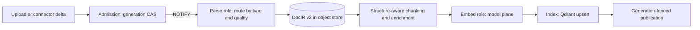

# 04 Knowledge (Knowledge API and Knowledge Worker)

按完整模块交付；进度只在[现有账本](../../../deploy/runbooks/native-enterprise-upgrade/loop-state.json)。
原始工作包用于需求与验收核对，执行顺序使用[主计划的三个批次](README.md#6-roadmap)。

## 1. 本模块要交付什么

把上传、解析、切分、嵌入、发布、检索和引用连成完整知识库流程，并让后台任务在真实权限与租户上下文中持续工作。

| 交付部分 | 原需求 ID | 连通的结果 |
| --- | --- | --- |
| 服务边界与模型调用 | `U-KN-01`, `U-KN-10` | 独立 Knowledge 域、API/Worker 和 Gateway 模型面完成接线。 |
| 入库与后台流水线 | `U-KN-02`, `U-KN-03`, `U-KN-04`, `U-KN-13` | 凭据隔离解析、DocIR、任务领取/心跳/检查点和 parse/embed/index 角色共同完成一份文档发布。 |
| 检索与模型生命周期 | `U-KN-05`, `U-KN-06`, `U-KN-07`, `U-KN-08`, `U-KN-09` | 索引、缓存、模型切换、混合/多模态检索及区域引用使用同一代际和 ACL。 |
| 连接器与质量晋级 | `U-KN-11`, `U-KN-12` | Confluence 增量/ACL 同步和评测晋级接到已有数据与发布流程。 |
| 收尾整理 | `U-KN-14` | 实际影响配置/遥测契约的部分随功能完成；纯旧名、标签与模块整理合并到功能贯通后的收尾。 |

以上部分在同一模块中连续完成，不分别创建小任务、审批、审核或交接记录。

## 2. 接线与真实依赖

模型接口由 Gateway 提供，执行隔离复用 Worker，持久化依赖数据模块。先完成前后台调用链；评测基线、压测和版本晋级在集成批次使用统一样本执行，不反复重建语料。

## 3. 一次集中验证与收尾边界

一次完整“上传→发布→检索→引用”联调覆盖主链，再覆盖跨租户/ACL 拒绝、并发代际与中断恢复。解析/检索质量使用原定指标和同一评测集；模块测试已有覆盖时不逐方法补局部测试。

不为旧 Python 名称、文件长度或标签一致性打断入库/检索实现；质量门槛、索引代际和引用权限仍是必需验收。

设计约束与技术选择（实现涉及该边界时按需查阅）

## 4. Target architecture

### 4.1 Crate extraction (U-KN-01, Stage F)

Measure first: compile scope, dependency graph, test time. Then move domain types, ingestion,
retrieval and adapters into `knowledge-domain`, `knowledge-ingest`, `knowledge-retrieval` and
`knowledge-adapters` (Qdrant, model plane, object store), with `knowledge-api` on top. They depend
on `contracts` (signed envelopes, canonical JSON) and never on the Gateway crate. Public wire hashes
and the signed envelope stay byte-identical.

### 4.2 Ingestion pipeline v2 (U-KN-02, U-KN-03, U-KN-04)

- **Claims (U-KN-03).** Document claims get heartbeat leases (for example 60 s, renewed at 20 s)
  with fence tokens. Admission commits `pg_notify` so an idle worker starts at once. The 1 s poll
  becomes a 10 s backstop, and the 30-minute stale threshold becomes lease expiry.
- **Stage checkpoints.** Persist DocIR v2 per document version in object storage, keyed by source
  hash and parser profile. Re-chunking or re-embedding then never re-parses, and a parser upgrade
  re-parses only what its profile changed.
- **Parser routing (U-KN-04).** A fast path for born-digital PDFs and Office files (text layer plus
  layout heuristics). A layout-aware VLM parser for scanned, complex or table-heavy documents
  (PaddleOCR-VL, MinerU or Granite-Docling behind an OpenAI-compatible endpoint, called through the
  Gateway model plane). Route on text-layer coverage, image ratio and table density, and record the
  decision in the version row.
- **DocIR v2.** Blocks typed as heading, paragraph, list, table (HTML and Markdown), figure (with
  caption and crop), formula (LaTeX) and code, with page number, bounding box and reading order.
  This gives citations with page and region, and real TEDS table evaluation.
- **Sandboxed parsing (U-KN-02).** Poppler, Tesseract and any converter run in the
  credential-free sandbox pool (03 §4.4), never in the API process. Evaluate PDFium (BSD-licensed)
  against Poppler (GPL utilities shipped in the image) for rendering speed, fidelity and the
  licence gate (U-PE-13).

### 4.3 Chunking and enrichment

- Chunk on DocIR structure: never split a table or formula; carry the section path.
- **Contextual chunk headers.** Prepend title, section path and a short document context to the
  text that is embedded. This generalizes the existing `prepend_summary` option. Keep the raw
  chunk for display and citations.
- Table and figure chunks carry their caption and VLM description, plus a link to the region
  crop.
- Near-duplicate detection (MinHash) across versions and documents, so re-uploads do not inflate
  recall lists.

### 4.4 Embeddings and index (U-KN-05, U-KN-08)

- **Semantic default (U-KN-08).** When a local endpoint is deployed, new datasets default to
  `local_semantic` (Qwen3-Embedding-0.6B served by TEI or vLLM), not `hash-384`. `hash-384`
  remains only for offline development profiles. Re-embedding uses the existing stable-identity
  path, and switching a profile is an eval-gated promotion (vNext DEC-06).
- **Qdrant 1.19 features (U-KN-05).**
  - Quantization: TurboQuant over full-precision vectors with rescoring for recall-sensitive
    datasets; Turbo4 4-bit storage for archive tiers, where the loss of full-precision rescoring
    is acceptable (WEB).
  - Memory tiers: pin HNSW links, cache sparse indexes, keep original vectors `cold` when they are
    quantized.
  - Consolidation: put small datasets in shared collections keyed by `tenant_id` and `dataset_id`
    with tiered multitenancy (a shared fallback shard, and large tenants promoted to dedicated
    shards without reindexing, since 1.16). Use **per-tenant IDF** (1.19) so BM25 scores for a
    dataset match what its own collection gives today. Keep dedicated collections for very large
    or strongly isolated datasets.
  - Use prefix keyword matching for path filters and the ACORN filtered-search mode for selective
    ACL filters.
- **Typed requests.** Build requests with the `qdrant-client` types directly instead of JSON values
  converted to gRPC, so field errors fail at compile time. The lexical profile fingerprint records a
  client version (`1.18.0`); bump it as a new profile version when the encoder contract changes,
  never in place.

### 4.5 Retrieval v2 (U-KN-07, U-KN-09)

- **Query understanding.** Normalization, language detection, rewriting for conversational
  follow-ups, and multi-query expansion for short queries. Each is a profile option promoted only
  when the golden set shows a gain.
- **Rerank cascade.** The CPU cross-encoder on the top 50, then an optional LLM or VL reranker
  (Qwen3-Reranker, `qwen3-vl-rerank`) on the top 10, both through the model plane. The cascade
  depth is per profile with a latency budget.
- **Citations.** Results carry document version, page and bounding box from DocIR v2, so answers
  cite regions, not only documents.
- **Caches (U-KN-07).** A `moka` result cache keyed by (dataset generation, ACL scope hash,
  normalized query, profile fingerprint) with size-aware eviction. A query-embedding cache keyed by
  (model, version, normalized text). Generation keys invalidate the cache on publication. No
  cross-ACL sharing.
- **Agentic retrieval** stays in the Runtime: the agent calls retrieval as a tool and can iterate.
  Knowledge offers fast primitives (search, fetch neighbours, fetch parent section). GraphRAG
  remains out of scope until an eval shows a gain (vNext non-goal).

### 4.6 Multimodal (U-KN-06)

- Page-image retrieval with late-interaction multi-vectors (ColPali- or ColQwen-style), stored as
  Qdrant multi-vectors. Turbo4 brings their size into a workable range. Alternatively, a provider
  vision embedding (`tongyi-embedding-vision-plus`) through the model plane.
- Figure and table regions from DocIR v2 indexed as image chunks with caption text.
- A VL reranker for mixed candidates. Answers return image citations (page crops).
- Enable per dataset through an eval-gated profile with a multimodal golden set. Lift the
  "unavailable in this release" refusal only for profiles that pass.

### 4.7 Model calls through the Gateway (U-KN-10)

Embeddings, rerank, OCR/VLM, QA generation and judge calls use the Gateway model plane with
service-scoped leases. Knowledge then holds no provider keys, every call gets a receipt, and tenant
budgets cover knowledge spend. A self-hosted endpoint is registered as a Gateway provider like any
other. Deadlines and batching stay with Knowledge.

### 4.8 Evaluation and promotion (U-KN-11)

- Golden sets per dataset class (text, scanned, tables, multimodal, multilingual) with Recall@k,
  nDCG@10 and MRR, plus parsing metrics (CER, full TEDS, reading-order accuracy).
- CI runs retrieval eval on a fixed corpus for every change to the ingestion or retrieval
  profiles. Promotion requires no regression on any profile (README §8).
- Calibrate the LLM judge against human labels each quarter. Online signals (citation clicks,
  thumbs, reformulations) feed candidate golden items, never automatic promotion.

### 4.9 Connectors and scale (U-KN-12, U-KN-13)

- **Connector framework.** Incremental delta sync, webhooks where available, ACL sync mapped to
  dataset and document permissions, and per-connector rate limits. Confluence moves onto it first,
  then SharePoint/OneDrive, Google Drive, Notion and GitHub. An MCP server may serve as a
  connector transport, under the Gateway MCP broker's governance.
- **Process roles.** `worker` splits into `parse`, `embed` and `index` roles of the same image,
  scaled by queue depth (KEDA on Kubernetes). No new service (ADR-008).

## 5. Technology upgrades

| Item | Current | Target | Notes |
| --- | --- | --- | --- |
| Qdrant server | 1.18.2 | 1.19.2 (Ph1), then each minor after a soak period | Quantization, memory tiers, per-tenant IDF |
| Qdrant requests | JSON values converted to `qdrant-client` 1.19.0 gRPC messages or sent over REST | `qdrant-client` typed builders end to end | Compile-time checked requests |
| PDF engine | Poppler executables | Poppler or PDFium in the sandbox pool (bake-off) | Fidelity, speed, licence |
| OCR and layout | Tesseract, general VLM prompt | PaddleOCR-VL / MinerU / Granite-Docling through the model plane; Tesseract as fallback | Parsing eval gate |
| Default embedding | `hash-384` | `local_semantic` (Qwen3-Embedding-0.6B) where deployed | Matryoshka truncation where supported |
| Rerank | DashScope, Cohere-compatible, Candle BGE v2-m3 | Same plus a model-plane cascade with Qwen3-Reranker | Latency budget per profile |
| ML runtime | Candle 0.11, tokenizers 0.22 | Current Candle/tokenizers at each sync window; ONNX Runtime only if a bake-off shows a gain | Keep Python-free serving |
| Cache | Linear `VecDeque` | `moka` with generation and ACL keys | F-18 |
| Work dispatch | 1 s poll, 30-minute recovery | Heartbeat leases, NOTIFY, 10 s backstop | F-20 |

## 6. Work packages

原始需求和验收对照；Prio / Phase 是原计划标签，不是逐项执行流程

| ID | Work package | Prio | Phase | Acceptance |
| --- | --- | --- | --- | --- |
| U-KN-01 | Crate extraction; no dependency on the Gateway crate (F-15) | P2 | Ph2 | Knowledge builds without `ai-platform-gateway`; wire hashes unchanged; compile-scope report |
| U-KN-02 | Parsing in the credential-free sandbox pool | P2 | Ph2 | No parser process can read secrets or reach the network; malformed-PDF corpus passes |
| U-KN-03 | Heartbeat claims, NOTIFY wake-ups, stage checkpoints (F-20) | P2 | Ph2 | Crashed-worker recovery ≤ 2 lease periods; re-embedding does not re-parse |
| U-KN-04 | Parsing v2: DocIR v2, VLM layout parser routing, tables and formulas | P1 | Ph2 | Parsing golden set: CER and TEDS improve on scanned and table-heavy classes; no regression on born-digital |
| U-KN-05 | Qdrant 1.19: quantization, memory tiers, per-tenant IDF, tiered multitenancy | P2 | Ph2 | Memory per million chunks reduced (target ≥ 4×) at equal Recall@20; BM25 score parity after consolidation |
| U-KN-06 | Multimodal retrieval (F-19) | P2 | Ph2–Ph3 | Multimodal golden set baseline, then promotion gate |
| U-KN-07 | Result and query-embedding caches v2 (F-18) | P2 | Ph2 | Cache-hit p95 < 20 ms; zero cross-ACL hits (negative tests) |
| U-KN-08 | Semantic default embedding and model lifecycle | P2 | Ph2 | New datasets get a semantic model when available; re-embedding migration tested |
| U-KN-09 | Retrieval v2: query understanding, rerank cascade, contextual headers, region citations | P2 | Ph2 | Golden-set nDCG@10 gain per enabled option; latency within README §8 budgets |
| U-KN-10 | All Knowledge model calls through the Gateway model plane (F-33) | P1 | Ph2 | Knowledge configuration holds no provider key; receipts for every call |
| U-KN-11 | Evaluation and promotion pipeline in CI; judge calibration | P1 | Ph1–Ph2 | Baselines recorded in Ph1; profile changes blocked on regression |
| U-KN-12 | Connector framework with ACL sync; Confluence first | P3 | Ph3 | Delta sync and ACL propagation tests per connector |
| U-KN-13 | `parse`, `embed` and `index` roles scaled by queue depth | P3 | Ph3 | Throughput scales linearly to the target node count |
| U-KN-14 | Python residue cleanup: telemetry labels (`fusion_applied_by: "python"`, [service.rs:574](../../../rust/platform-native/crates/platform-knowledge-domain/src/migration_knowledge_query/service.rs)), parity module names, typed configuration (F-16) | P3 | Ph2 | Dashboards migrated before labels change |

## 7. Verification gates

以下场景在上述模块验证和最终验收批次中覆盖。同一场景由一个执行者运行一次，关联
多个需求即可；未变化的适用结果直接复用。关键边界和原门槛不能由重复的局部测试替代。

- **Retrieval quality.** Golden-set Recall@k, nDCG@10 and MRR per profile; shadow comparison
  before promotion; per-tenant IDF score-parity test before consolidation.
- **Parsing quality.** CER and WER for OCR, full TEDS for tables, reading-order accuracy, and a
  malformed and adversarial document corpus.
- **Isolation.** ACL negative suite across datasets and tenants for retrieval, caches and
  citations; signed-envelope replay and substitution tests.
- **Publication.** Concurrent publish-and-query tests prove the generation fence: no mixed
  generations in one result.
- **Cost and latency.** Cost per 1,000 pages by parser route; p95 latency per pipeline stage;
  memory per million chunks.

已有实现说明与历史结果（不自动变成当前任务或当前验收）

### U-KN-11 implementation entry point (2026-10-17)

The native offline measurement gate, CI integration and synthetic positive/negative contract tests
are documented in [Knowledge evaluation and promotion](knowledge-evaluation-promotion.md).
This records implementation only: production baseline captures, reviewed corpora, human/judge
calibration and live quality acceptance remain open. Existing starter fixtures are not quality evidence.

