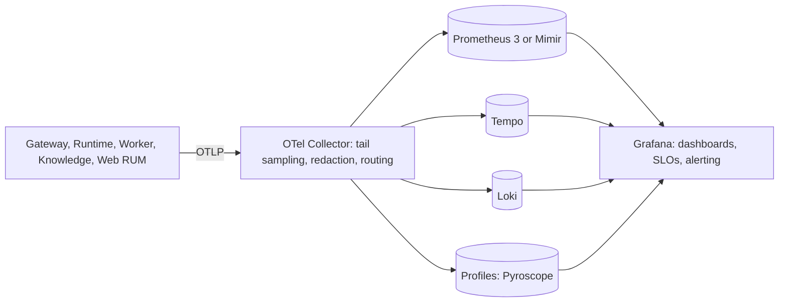

# 08 Platform engineering (observability, security and supply chain, CI/CD, deployment, harness)

按完整模块交付；进度只在[现有账本](../../../deploy/runbooks/native-enterprise-upgrade/loop-state.json)。
原始工作包用于需求与验收核对，执行顺序使用[主计划的三个批次](README.md#6-roadmap)。

## 1. 本模块要交付什么

让当前代码能通过一个可复用构建流程形成正确镜像、部署成可观测服务，并完成原定发布与恢复验收。

| 交付部分 | 原需求 ID | 连通的结果 |
| --- | --- | --- |
| 镜像与部署入口 | `U-PE-01`, `U-PE-20`, `U-PE-22`, `U-PE-30`, `U-PE-32` | 配对镜像、Compose/Helm、安全网络与运行配置随真实服务接线一起交付。 |
| CI 与供应链 | `U-PE-03`, `U-PE-13`, `U-PE-14`, `U-PE-15`, `U-PE-21` | 共享构建缓存、原生架构产物、依赖/许可与签名扫描形成可用发布流程。 |
| 服务信任与观测 | `U-PE-10`, `U-PE-11`, `U-PE-12` | 文件凭据、mTLS、轮换及 trace/metric/log 接到实际服务链。 |
| 统一测量与发布演练 | `U-PE-04`, `U-PE-31` | 使用集成候选集中测量基线并完成渐进发布/回滚演练，不按模块重复搭台。 |
| 项目说明与约束 | `U-PE-02`, `U-PE-40` | 只维护真实入口、命令和有效约束；复用现有 harness，不再新增报告/审计体系。 |

以上部分在同一模块中连续完成，不分别创建小任务、审批、审核或交接记录。

## 2. 接线与真实依赖

构建验证与运行联调由主任务按本机资源串行安排，沿用一份 Docker 缓存和现有拓扑。源码开发不依赖 CI 容量调查、监控部署、发布签名或提前重建全部镜像。

## 3. 一次集中验证与收尾边界

集中做配置/镜像身份检查和受影响构建，再随统一服务联调验证可观测链。正式发布保留签名、漏洞、许可、Helm、轮换和回滚要求；同一结果覆盖多个包，不另造逐项 gate。

文档日期、无实际风险的规则扩张、全仓周期扫描和单独 ADR 编号不阻塞当前交付；真实部署错误、供应链风险和凭据问题仍需修复。

设计约束与技术选择（实现涉及该边界时按需查阅）

## 4. Target architecture

### 4.1 Observability (U-PE-10, U-PE-11, P-ADR-10)

- **One pipeline (U-PE-10).** Replace the 2023 overlay with one observability profile: the current
  OTel Collector (contrib), Prometheus 3 (Mimir when multi-tenant retention is needed), Tempo as
  the only trace backend (drop Jaeger), Loki 3 for logs, Pyroscope for continuous profiling, and
  Grafana 12 or later. Dashboards and alerts live as code. The profile reuses the main stack's
  PostgreSQL and Redis instead of duplicating them.
- **Instrumentation (U-PE-11).** Every Rust service uses OpenTelemetry Rust 0.32 with
  `tracing-opentelemetry` and the OTLP log appender, for traces, metrics and logs with exemplars.
  W3C trace context crosses every hop (Stage D). The web console reports RUM (U-WEB-06).
- **GenAI semantics.** Pin one version of the GenAI semantic conventions; they are still mostly
  "Development" (WEB). Spans: `chat`, `embeddings`, `execute_tool`, `invoke_agent`. Metrics: token
  usage, operation duration, time to first token. Prompt and response content capture is off by
  default and tenant-opt-in with redaction in the Collector.
- **Platform metrics that matter.** Gateway overhead against provider time (README §8), admission
  rejections by reason, prompt-cache hit ratio, cost per tenant and model, tool latency and
  approval wait, retrieval stage latencies, ingestion throughput, fence violations (always 0).
- **SLOs.** SLOs with multi-window burn-rate alerts for the API, streaming first byte, agent turn
  completion, retrieval and ingestion. Alerts route by owning context.

### 4.2 Security and supply chain (U-PE-12, U-PE-13, U-PE-14, U-PE-15, U-PE-22)

- **Workload identity and secrets (U-PE-12).** On Kubernetes, SPIFFE identities through SPIRE or a
  mesh in ambient mode (Istio or Linkerd) for mTLS between services. On Compose, a small internal
  CA with file-mounted certificates. Secrets come from files: Docker secrets, or External Secrets
  Operator with Vault or a cloud KMS. Retire `AI_PLATFORM_INTERNAL_TOKEN` after the mTLS rollout,
  with a dual-acceptance window. Rotation is drilled.
- **Supply chain (U-PE-13).**
  - Pin actions by commit SHA, with Renovate updating them. Add least-privilege `permissions:`
    blocks to every workflow and lint workflows with `zizmor`.
  - `cargo-deny` (advisories, licences, bans, sources) and RustSec; `pnpm audit` with lockfile
    linting.
  - Scan images with Trivy or Grype; triage with VEX documents.
  - Sign images keylessly with cosign and attach build provenance attestations, targeting SLSA
    Build Level 3. Verify signatures at deploy time: a policy controller on Kubernetes,
    `cosign verify` in the Compose deploy script.
  - Run OpenSSF Scorecard. Gate licences from the SBOM, including GPL utilities such as Poppler
    (04 §4.2).
- **Dependencies (U-PE-14).** Replace `serde_yaml` (archived) in the seven native crates with a
  maintained fork. Remove `rustpython-*` together with the eval parity modules that use it. Let
  Renovate group updates, and declare shared dependencies once in `[workspace.dependencies]`
  (today eight crates each declare `sqlx 0.8` with different feature sets, and six declare `axum`).
- **Licence (U-PE-15).** The owner decides with legal advice. Recommendation: Apache-2.0 with a
  `NOTICE` file across the repository, CLI and SDKs, consistent with the Apache-2.0 upstream
  overlay and the crates' declared licence, plus SPDX headers and third-party notices generated
  from the SBOM.
- **Containers and network (U-PE-22).** Every service gets `cap_drop: [ALL]`, `read_only: true`,
  `no-new-privileges`, PID limits, `tmpfs` for scratch and non-root users. Compose networks are
  split into `edge`, `app` and `data`. Kubernetes uses the Pod Security `restricted` profile and
  default-deny NetworkPolicies.

### 4.3 Build and CI (U-PE-03, U-PE-20, U-PE-21)

- **Capacity first (U-PE-03).** Hosted runners sized for the workspace, `sccache` with a remote
  cache, `cargo-nextest`, and `CARGO_BUILD_JOBS` derived from runner cores in CI (the one-job rule
  protects the memory-tight local host, not CI). Target: PR CI p50 ≤ 20 min (README §8).
- **One Dockerfile (U-PE-20).** A single Dockerfile or `docker-bake.hcl` with per-binary targets.
  Use `cargo-chef` dependency layers and Debian 13 slim or distroless `cc` bases, so each image
  carries only its binary and runtime needs (Poppler only in the parser image). Image size budgets
  are enforced in CI.
- **Native multi-arch (U-PE-21).** Build arm64 on native arm64 runners (GitHub-hosted
  `ubuntu-24.04-arm` or self-hosted) in parallel with amd64, then merge manifests. No QEMU for Rust.
- **Toolchains.** `rust-toolchain.toml` (1.99.0 today) moves with Renovate after a soak period. The
  Runtime follows upstream's toolchain at each sync window (03 §5).

### 4.4 Deployment (U-PE-01, U-PE-30, U-PE-31, U-PE-32)

- **Compose identity (U-PE-01, Ph0).** One image variable per code unit (`WEB_IMAGE` separate from
  `KNOWLEDGE_IMAGE`). Knowledge API and worker share one image by construction. Runtime and Worker
  come from one release manifest as a pair. Release profiles pin digests. A CI check renders
  `docker compose config` and asserts these rules.
- **Compose profiles (U-PE-32).** Fold the 11 overlays into Compose profiles and `include:` with a
  documented matrix. `make hot-update` and `make status` keep their meaning.
- **Helm v2 (U-PE-30).** A new chart for the Rust topology:
  - All units, including the Runtime, Capability Worker (control and sandbox pools) and Knowledge
    roles, plus Gateway process roles.
  - `migrate` as a pre-install/pre-upgrade Job that runs the native authority.
  - Operators for state: CloudNativePG, Qdrant's chart in distributed mode, and Valkey.
  - Gateway API `HTTPRoute`/`GRPCRoute`, cert-manager, External Secrets.
  - HPA or KEDA (queue depth for Knowledge roles), PodDisruptionBudgets, topology spread,
    `RuntimeClass` for the sandbox pool (03 §4.4), NetworkPolicies, digest-pinned images.
  - Chart tests: `helm unittest`, `kubeconform`, `chart-testing` against a kind cluster in CI.
- **GitOps and progressive delivery (U-PE-31).** Argo CD or Flux promotes signed digests between
  environments. Argo Rollouts canaries are gated on the SLOs from §4.1.

### 4.5 Harness, docs and architecture fitness (U-PE-02, U-PE-04, U-PE-40)

- **Docs truth (U-PE-02, Ph0).** Keep native startup, architecture and changed interface instructions
  accurate. Reuse accepted decisions; fix stale operational references when the owning module is
  delivered. Check missing scripts, broken references and obsolete commands; calendar age is not
  a failure and does not require date refreshes, historical rewrites or repository-wide sweeps.
- **Performance baseline (U-PE-04, Ph0).** Run the
  [enterprise performance contract](../../design/enterprise-performance-contract.md) harness with
  a deterministic mock provider on the accepted build. Record Gateway overhead, retrieval stage
  latencies, ingestion throughput and RSS per service. These baselines gate later phases.
- **Gates for recurring findings (U-PE-40).** Reuse checks in `platform-tools`, run by
  `make harness-check`, for concrete deployment, dependency and security failures. Implement a
  missing check with its owning module and run the consolidated suite; do not add duplicate gates
  or standalone housekeeping packages for individual edits:

  | Check | Prevents |
  | --- | --- |
  | Unique image per code unit; Runtime/Worker pairing | F-01, F-02 |
  | No superuser DSN in service configuration | F-05 |
  | No tag-pinned actions; workflow `permissions:` present | F-23 |
  | Coordination store eviction policy is `noeviction`; Qdrant API key configured | F-39, F-40 |
  | Hardening keys present on every service | F-36 |
  | Crate dependency rules (Knowledge crates never depend on the Gateway crate; `contracts` has no I/O) | F-15, P-ADR-4 |
  | No provider credential in Knowledge or SDK-worker configuration | F-11, F-33 |
  | Supported base images (no end-of-life nginx, Debian or Python lines) | F-22, F-37 |

## 5. Technology upgrades

| Item | Current | Target | Notes |
| --- | --- | --- | --- |
| Collector | 0.88 (overlay) | Current contrib release | Tail sampling, redaction |
| Metrics | Prometheus 2.47 | Prometheus 3 (Mimir if multi-tenant) | — |
| Traces | Tempo 2.5.0 and Jaeger 1.51 | Tempo only | One backend |
| Logs | None | Loki 3 via OTLP | — |
| Profiles | None | Pyroscope (OTel profiles when stable) | — |
| Dashboards | Grafana 10.2 | Grafana 12 or later | Dashboards as code |
| OTel Rust | 0.31, traces only | 0.32, all signals | F-14 |
| Actions | Tag-pinned | SHA-pinned via Renovate; `zizmor` | F-23 |
| Image integrity | SBOM and provenance | Plus cosign signing, scanning, deploy-time verification | SLSA Build L3 target |
| arm64 builds | QEMU | Native runners | F-23 |
| Bases | Debian 12, toolchain image, nginx 1.27 | Debian 13 slim or distroless; nginx 1.30 | F-22, F-37 |
| Kubernetes | Python-era chart | Helm v2 with operators and Gateway API | F-12 |
| Secrets | Environment variables, shared bearer | Files and External Secrets; mTLS identities | F-04 |

## 6. Work packages

原始需求和验收对照；Prio / Phase 是原计划标签，不是逐项执行流程

| ID | Work package | Prio | Phase | Acceptance |
| --- | --- | --- | --- | --- |
| U-PE-01 | Compose image identity and pairing checks (F-01, F-02) | P0 | Ph0 | Rendered config check passes; web, Knowledge and Runtime/Worker identities distinct and paired |
| U-PE-02 | Docs truth pass and P-ADR-1 draft (F-31) | P2 | Ph0 | Live docs describe Rust defaults; no references to deleted scripts |
| U-PE-03 | Hosted CI capacity: runners, `sccache`, `nextest`, job parallelism | P1 | Ph0 | PR CI p50 measured, then ≤ 20 min |
| U-PE-04 | Performance baselines on the accepted build | P1 | Ph0 | Baseline report checked in under `reports/` |
| U-PE-10 | Observability stack v2 (F-13) | P1 | Ph1 | One trace backend; dashboards and SLO alerts as code |
| U-PE-11 | OTLP traces, metrics and logs in every service; pinned GenAI conventions (F-14) | P1 | Ph1 | End-to-end trace from browser to Worker; token and cost metrics per tenant |
| U-PE-12 | Workload identity (mTLS) and file-based secrets; shared bearer retired (F-04) | P1 | Ph1–Ph2 | No long-lived secret in environment variables; rotation drill |
| U-PE-13 | Supply-chain gates: pinning, `permissions:`, `cargo-deny`, scanning, signing, verification (F-23) | P1 | Ph1 | Unsigned or critically vulnerable image cannot deploy |
| U-PE-14 | Dependency hygiene: `serde_yaml` replacement, `rustpython` removal, version unification (F-26) | P2 | Ph1–Ph2 | `cargo-deny` clean with no exceptions for these crates |
| U-PE-15 | Licence alignment (F-24) | P2 | Ph0–Ph1 | One licence declared consistently; NOTICE and third-party notices generated |
| U-PE-20 | One Dockerfile with per-binary images and slim bases (F-22) | P2 | Ph1 | Five copies removed; image size budgets met |
| U-PE-21 | Native arm64 builds and merged manifests (F-23) | P2 | Ph1 | Release build ≤ 45 min (README §8) |
| U-PE-22 | Container hardening and network segmentation (F-36, F-39) | P1 | Ph1 | Hardening check passes for every service; data stores unreachable from the edge |
| U-PE-30 | Helm v2 for the Rust topology with operators (F-12) | P1 | Ph2–Ph3 | Chart tests on kind; install, upgrade and rollback rehearsed |
| U-PE-31 | GitOps and SLO-gated progressive delivery | P3 | Ph3 | Canary rollback triggered automatically in a drill |
| U-PE-32 | Compose overlays folded into profiles | P3 | Ph2 | Documented matrix; `make hot-update` unchanged |
| U-PE-40 | Harness checks for this review's recurring findings | P2 | Ph1 | Each check has a negative test in the gate self-test |

## 7. Verification gates

以下场景在上述模块验证和最终验收批次中覆盖。同一场景由一个执行者运行一次，关联
多个需求即可；未变化的适用结果直接复用。关键边界和原门槛不能由重复的局部测试替代。

- `make harness-check` and the gate-enforcement self-test include every U-PE-40 check, each with a
  negative case.
- Release: signatures, provenance and SBOM verified for every image; scan results under the
  critical-vulnerability budget; licence gate passes.
- Observability: synthetic journeys produce complete traces; alert rules are unit-tested with
  recorded data.
- Deployment: Helm install, upgrade and rollback on kind in CI; Compose rendered-config checks;
  quarterly disaster-recovery drill (U-DATA-06).

已有实现说明与历史结果（不自动变成当前任务或当前验收）

### U-PE-14 eval interpreter removal implementation (2026-10-17)

The RustPython-dependent `parity_support/reserve.rs` interpreter is removed. Existing native
scenario/result validators retain their implementations; the Python work-product benchmark uses
an explicit pinned user-code sandbox with genuine CPython and a native typed outcome scorer.
Its prompt, generated Python artifact and all former source/behavior regression cases are retained.
See [execution contract, fixture gate and compatibility commands](../../../tests/fixtures/eval/parity_python_reserve/README.md).
This is implementation evidence only: Rust compilation, actual isolated fixture execution and
cargo-deny/dependency removal remain primary verification steps. No live benchmark or image build
was performed for this change.

