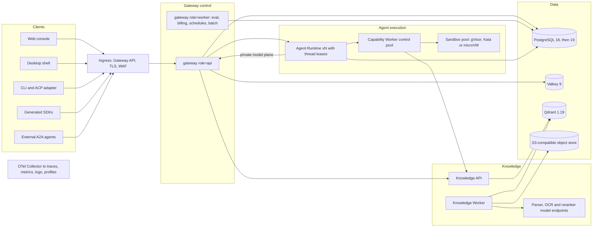

# Platform upgrade plan 2026-10: Rust-native architecture, trust and AI-gateway capability

| Field | Value |
| --- | --- |
| status | **adopted for execution (2026-10-17)**. The owner requested full implementation and required acceptance. Package status is recorded only in the existing program ledger; this document remains the scope and acceptance contract. |
| domain_id | `platform-upgrade-2026-10` |
| owner | Architecture. One primary writer per [`work-packages.md`](../../harness/work-packages.md); reviewers work on disjoint paths. |
| last_verified | 2026-10-16, source review of HEAD `22d9ce0` (clean tree). External technology facts were checked on the same date (see §11). |
| execution authority | [`native-enterprise-upgrade/loop-state.json`](../../../deploy/runbooks/native-enterprise-upgrade/loop-state.json) remains the only status ledger. |
| builds on | [Agent platform vNext PRD](../agent-platform-vnext-2026-09/README.md) (three phases, DEC-01…08) and [cross-service architecture evolution](../../design/cross-service-architecture-evolution-2026-10-12.md) (Stages A–F) |
| successor | null |

## 0. How to read this plan

| File | Content |
| --- | --- |
| [01 Baseline and findings](01-baseline-and-findings.md) | What was reviewed, version baseline (current → target), verified findings register, strengths to keep |
| [02 Gateway](02-gateway.md) | Gateway control service: identity, policy, model plane, admission, accounting, brokers |
| [03 Agent execution](03-agent-execution.md) | Agent Runtime, Capability Worker, optional SDK Agent Worker |
| [04 Knowledge](04-knowledge.md) | Knowledge API and Worker: ingestion, indexing, retrieval, evaluation |
| [05 Web console](05-web-console.md) | React console and its serving container |
| [06 Clients and edge](06-clients-and-edge.md) | Local Node, desktop, platformctl/`platform-client`, independent CLI, SDKs |
| [07 Data platform](07-data-platform.md) | Database migration authority, PostgreSQL, Valkey/Redis, Qdrant, object storage |
| [08 Platform engineering](08-platform-engineering.md) | Observability, security and supply chain, CI/CD, deployment, harness and docs |

Each service file uses the same structure: role → current architecture → assessment → target
architecture → technology upgrades → functional improvements and optimizations (prioritized work
packages) → verification gates.

Evidence labels: **SRC** = read in this repository at HEAD `22d9ce0`; **WEB** = external fact checked
2026-10-16 (§11); **TARGET** = recommendation. Nothing here was built, run, load-tested or
deployed for this review, so no statement below is a performance or acceptance result.

Work-package IDs use a `U-` prefix (`U-GW-05`, `U-KN-03`, …) so they cannot collide with vNext
requirement IDs (`GW-01`, `KB-03`, …). Priority is `P0` (release/safety blocker) to `P3`
(opportunistic). Phases are `Ph0`–`Ph3` (§6).

## 1. Executive summary

1. **The product surface is broad and the engineering discipline is unusually rigorous.** Single
   managed kernel, signed immutable launches, Capability Contract V2 with unknown-effect barriers,
   generation-fenced knowledge publication, a fingerprinted migration authority and an evidence
   culture are real assets. Preserve them.
2. **The main architectural debt is that the Rust services are a parity port of the deleted Python
   services.** 363k lines of native Rust keep Python semantics on purpose: `python_json`
   canonicalization, Python float spelling, CPython integer limits, wall-clock circuit breakers,
   `serde_json::Value` domain records, process-local state and `migration_*` module names whose
   doc comments cite `src/*.py` files that no longer exist. On 2026-10-15 the owner authorized a
   Rust-native architecture upgrade ([migration status](../../migration/full-rust-status.md)).
   This plan turns that authorization into a contract-preserving, step-by-step conversion from
   ported code to typed domain crates. It is not a rewrite.
3. **Release and deployment integrity has concrete defects to fix first.** In the primary Compose
   file the web frontend resolves to the Knowledge image tag. The Knowledge API and Worker default
   to different images. The native Dockerfile exists in five copies. The Helm chart still
   describes the Python gateway, and the monitoring stack dates from 2023. These are small fixes
   with a large blast radius (F-01, F-02, F-12, F-13, F-22).
4. **Several operational risks are cheap to remove and should not wait for the refactor.** The
   Capability Worker runs every tool call for every tenant through one execution slot (F-34). One
   LRU-evicting Redis holds sessions, capacity leases and rate windows (F-40). Qdrant has no
   authentication on a network shared by every container (F-39). Backups are a logical `pg_dump`
   with no point-in-time recovery or vector snapshots (F-38). The web edge runs an unsupported
   nginx line (F-37).
5. **The trust model relies on shared symmetric secrets and a bootstrap superuser DSN.** Gateway,
   Runtime and Worker share one HMAC capability-lease secret, so the service that verifies leases
   can also mint them for any tenant.
   Upgrade to verify-only asymmetric credentials (Ed25519), workload identity, per-service
   database roles, HttpOnly console sessions and enterprise SSO.
6. **AI-gateway capabilities lag 2026 norms.** Missing pieces: provider-native inbound APIs
   (OpenAI Chat/Embeddings/Models, Anthropic Messages), versioned routing and price books,
   token-aware admission, prompt-cache passthrough and accounting, a guardrails stage, support for
   the stateless MCP `2026-07-28` revision, A2A v1.0 interoperability and OpenTelemetry GenAI
   telemetry.
7. **Knowledge retrieval is strong; parsing and multimodal are the weak links.** Layout-aware and
   VLM-OCR parsing, the Qdrant 1.19 features (per-tenant IDF, 4-bit storage, memory tiers) and
   late-interaction retrieval give the largest quality and cost gains. Extracting the domain from
   the Gateway crate graph comes first.
8. **Delivery in four phases over about nine months, aligned with the vNext phases** (§6):
   stabilize the current native build → correctness and trust foundations → Rust-native domains
   and product capabilities → scale-out, isolation and ecosystem.

## 2. Scope

| Service / unit | Context (ADR-008) | Source | Plan |
| --- | --- | --- | --- |
| `gateway` | gateway-control | `platform-gateway`, `-foundation`, `-integrations`, `platform-auth` | [02](02-gateway.md) |
| `agent-runtime` | agent-execution | overlay `ai-platform-agent-runtime` + pinned Codex App Server/Core | [03](03-agent-execution.md) |
| `agent-capability-worker` | agent-execution | overlay `ai-platform-capability-worker`, `-capability-contract`, `-office` | [03](03-agent-execution.md) |
| `sdk-agent-worker` (optional) | agent-execution (ADR-012) | `platform-sdk-agent-worker` + `ai-platform-sdk-agent-engine` | [03](03-agent-execution.md) |
| `knowledge-service`, `knowledge-worker` | knowledge | `platform-knowledge-service` + knowledge modules in `platform-gateway-integrations` | [04](04-knowledge.md) |
| `frontend` | product-surface | `web/` | [05](05-web-console.md) |
| Local Node, desktop, platformctl, CLI, SDKs | client / edge | `platform-local-node`, `platform-desktop`, `platform-client`, `sdk/` | [06](06-clients-and-edge.md) |
| `migrate`, PostgreSQL, Redis, Qdrant, object store | infrastructure | `platform-migration-authority`, `database/` | [07](07-data-platform.md) |
| CI/CD, telemetry, deployment, supply chain, harness | cross-cutting | `.github/`, `docker/`, `deploy/`, `platform-tools` | [08](08-platform-engineering.md) |

## 3. Current-state scorecard

| Dimension | Rating | Evidence (details in [01](01-baseline-and-findings.md)) |
| --- | --- | --- |
| Correctness discipline | Strong | One-authority rules, signed launches, unknown-effect barriers, durable cursors, generation fences |
| Domain modularity | Weak | Gateway is ~250k lines in three crates with a flat ~136-module foundation; Knowledge compiles inside the Gateway crate graph (F-15) |
| Type safety at the core | Weak | Provider/model/routing records and config are `serde_json::Value`; Python-compatible semantics in hashing and numbers (F-16) |
| Trust and identity | Gap | Shared HMAC secrets, static internal bearer, superuser DSN in Compose, HS256 user JWT in `localStorage`, no SSO/SCIM/MFA, unauthenticated Qdrant on a flat network (F-04, F-05, F-07, F-08, F-39) |
| Scalability / HA | Gap (declared) | Gateway and Runtime are single-instance by design; in-process cancellation and broadcast state (F-10); one tool-execution slot per Worker (F-34) |
| Recovery and coordination safety | Gap | Logical `pg_dump` only, no PITR or vector snapshots (F-38); admission state in an LRU-evicting Redis (F-40) |
| Observability | Adequate → gap | OTel traces only, stale monitoring stack, no GenAI conventions (F-13, F-14) |
| Delivery and supply chain | Gap | Native Dockerfile in five copies, toolchain image as the Runtime base, tag-pinned actions, no dependency/licence/vulnerability gates or signing, QEMU arm64 Rust builds (F-22, F-23) |
| AI-gateway capability | Gap | Inbound API limited to `/v1/responses` plus registered proxy routes; pricing keyed only by model name; no guardrails (F-03, F-29, F-30) |
| Knowledge / RAG | Strong retrieval, weak parsing | Hybrid, RRF, rerank and hierarchical retrieval exist; poppler text extraction; multimodal disabled (F-19) |
| Docs truth | Drifting | Live docs still describe Python defaults and reference deleted scripts (F-31) |

## 4. Architectural principles for this upgrade

1. **Strangler, not rewrite.** Public wire contracts, event vocabularies, canonical schema history
   and signed envelopes stay stable. Internals move behind ports one domain at a time, with
   expand → migrate → contract windows (vNext §3.7).
2. **Typed domain core, JSON only at the edges.** Domain types own invariants. `serde_json::Value`
   is for pass-through payloads and forward-compatible extension fields only.
3. **One authority per fact** (existing law). Every persistent object has one owner and named
   writers, and every protocol has one producer of record and shared fixtures.
4. **Verify-only by default.** A service that verifies an authority must not be able to mint it.
   Use asymmetric keys with key IDs and rotation, workload identity between services and
   least-privilege database roles.
5. **Durable state lives in PostgreSQL.** Valkey/Redis is for ephemeral coordination and
   acceleration. Process-local state must be declared, bounded and either instance-affine or
   replicated.
6. **Measure before split.** No new resident service without capacity, isolation or
   failure-domain evidence (ADR-008 stays in force for topology). Process *roles* of an existing
   image are the default scaling tool.
7. **Evidence-gated adoption.** Every technology change names its gate, its rollback and the
   metric it must not regress. Versions are pinned; Renovate proposes upgrades; nothing tracks
   `latest`.

## 5. Target architecture (end of Ph3)

Target properties:

- **Same three bounded contexts** (ADR-008), but with *process roles*. `gateway --role api|worker`
  mirrors Knowledge's existing `api|worker` roles, so eval, billing and scheduled work can be
  isolated without a new service.
- **Verify-only internal trust.** The Gateway signs model leases and per-turn capability ceilings
  with Ed25519; the Runtime only narrows a ceiling per call. Runtime, Worker and Knowledge hold
  public keys only. Internal hops use workload identity (mTLS)
  instead of one static bearer token.
- **Horizontally scalable execution.** Runtime threads are owned through PostgreSQL leases with
  fence tokens, extending today's per-run execution claims. LISTEN/NOTIFY wakes subscribers, while the durable event log stays the source of
  truth.
- **Tiered isolation.** Untrusted code and document parsing run in a sandbox pool behind a
  hardened runtime class. Control-plane tools never share a process with untrusted code.
- **Native crate topology.** Each context has domain, application, adapter and API crates.
  Knowledge no longer links the Gateway crate.

## 6. Roadmap

Indicative dates assume one primary integrator, four engineers on disjoint paths (Gateway,
Execution, Knowledge, Web/clients), part-time SRE capacity and hosted CI runners. Fewer people
stretches the dates; the dependency order does not change.

| Phase | Window | Goal | Main work packages | Exit criteria |
| --- | --- | --- | --- | --- |
| **Ph0 Stabilize** | 2026-10-19 → 2026-11-13 | Accept the current native build; remove deployment hazards | Active program blockers (current Gateway/Runtime/Worker images, Knowledge vector/version fixes, Local Node 023); U-PE-01 Compose image identity; U-WEB-09 supported nginx image; U-PE-02 docs truth; U-PE-03 hosted CI capacity; U-PE-04 performance baseline | native-enterprise-upgrade receipts for Assistant, Knowledge and Local Node journeys; Compose renders deterministic image identities; architecture docs describe Rust defaults |
| **Ph1 Foundations** | 2026-11-16 → 2027-01-29 | Correctness and trust | Stages A–D (U-RT-01/02, U-GW-20 schema admission, trace propagation); U-GW-02 Ed25519 leases; U-DATA-02 per-service roles; U-GW-03 sessions and Argon2id; U-GW-01 price book v2; U-DATA-01 PostgreSQL 18; U-DATA-05 Valkey 9; U-DATA-07 Qdrant 1.19.2; U-PE-10…14 telemetry and supply chain; U-PE-20 Dockerfile consolidation; U-CW-01 seccomp/Landlock baseline; U-CW-02 Worker execution pools; U-RT-05 history compatibility; U-DATA-06 PITR and snapshots; U-DATA-08 Qdrant authentication; U-PE-22 container and network hardening | Fault-injection suite green for terminal states; no verifier holds a signing secret; all images signed and scanned; OTel traces, metrics and logs flowing |
| **Ph2 Native domains and capabilities** | 2027-02-01 → 2027-04-30 | Typed Rust-native domains; competitive AI-gateway features | U-KN-01 Knowledge crate extraction; U-GW-17 typed routing/catalog; U-GW-05 inbound LLM APIs; U-GW-06 routing policy v1; U-GW-07 token-aware admission; U-GW-08 prompt caching; U-GW-09 guardrails; U-GW-10 MCP 2026-07-28; U-GW-04 SSO/SCIM/passkeys; U-CL-10 OpenAPI 3.2 and generated SDKs; U-WEB-01…08; U-KN-04…09 parsing v2, Qdrant features, multimodal; U-DATA-03 partitioning; U-SW-01 SDK engine through model plane; U-CW-04 credential-free sandbox pool; U-RT-04 per-thread fan-out | Contract diffs clean; eval-gated RAG and routing promotions; generated SDKs pass the shared conformance fixtures |
| **Ph3 Scale and ecosystem** | 2027-05-03 → 2027-07-30 | Multi-instance, strong isolation, interoperability | U-RT-03/04 Runtime leases and fan-out; U-GW-14 Gateway multi-instance; U-CW-03 sandbox runtime class; U-PE-30 Helm v2 with operators and GitOps; U-DATA-01b PostgreSQL 19 (after GA and first minor); U-GW-15 A2A v1.0; U-CL-01 desktop GA; U-CL-05 cross-platform CLI; optional analytics tier and gated cache/routing experiments | Single-instance release assumption retired only with failover evidence; sandbox escape test suite green; RPO/RTO drills pass |

Mapping to existing plans: Ph1 corresponds to vNext phase one ("trusted runtime foundation") and
Stages A–D; Ph2 to vNext phase two ("quality-driven workbench") plus Stage E/F; Ph3 to vNext phase
three ("operable scale and ecosystem"). This plan adds Rust-native refactoring, trust, platform
upgrades and 2026 protocol work. Requirements that already exist in the vNext PRD keep their IDs
and owners.

## 7. Decision backlog (proposed ADRs)

Numbers are placeholders; the owner assigns real ADR numbers when drafting.

| ID | Decision | Supersedes / amends | Needed by |
| --- | --- | --- | --- |
| P-ADR-1 | Rust-native platform baseline; architecture entrypoint rewritten for native defaults | ADR-008 §2 ("polyglot is permanent"), vNext DEC-01, `architecture.md` §1–3 | Ph0 |
| P-ADR-2 | Service identity and signed authority: workload identity (mTLS), Ed25519 leases with key IDs, verify-only consumers, attenuable capability tokens | ADR-007 transport notes; internal token usage | Ph1 |
| P-ADR-3 | Canonical JSON v2 (RFC 8785 JCS) for hashes and signatures; `python_json` frozen as the v1 verifier | ADR-011 canonical hash notes | Ph1 |
| P-ADR-4 | Native crate topology and process roles; Knowledge independent of the Gateway crate | Stage F of the cross-service evolution | Ph2 |
| P-ADR-5 | Price book and usage ledger v2 (provider/model/version/effective range; cached and reasoning token components) | Current `model_pricing` contract | Ph1 |
| P-ADR-6 | SDK execution scope: native engine through the Gateway model plane; A2A for external frameworks | ADR-012 | Ph2 |
| P-ADR-7 | Sandbox isolation tiers: seccomp + Landlock baseline; gVisor/Kata/microVM tier | Capability Worker deployment notes | Ph1 (baseline), Ph3 (tier) |
| P-ADR-8 | Desktop shell: Tauri 2 vs the existing egui app | vNext DEC-07 vs `platform-desktop` | Ph2 |
| P-ADR-9 | Enterprise identity: OIDC/SAML SSO, SCIM 2.0, passkeys, BFF session cookies, EdDSA API tokens | `platform-auth` HS256 profile | Ph1–Ph2 |
| P-ADR-10 | Telemetry: OTLP for all signals, pinned GenAI semantic conventions, telemetry data tier | Monitoring Compose overlay | Ph1 |
| P-ADR-11 | Coordination substrate: Valkey 9; durable-versus-ephemeral rule for streams and caches | Redis 7 profile | Ph1 |
| P-ADR-12 | LLM inbound API surface; passthrough-first protocol translation policy | Transparent proxy and Responses notes | Ph2 |

## 8. Success metrics

These are **targets to validate**, not measurements. Ph0 establishes baselines with the
[enterprise performance contract](../../design/enterprise-performance-contract.md); each target
is confirmed or revised by ADR before it gates a release.

| Area | Metric | Target |
| --- | --- | --- |
| Gateway overhead | Added latency against a deterministic mock provider, non-streaming, p99 | ≤ 30 ms |
| Gateway overhead | First-byte overhead for streaming, p95 | ≤ 50 ms |
| Gateway hot path | Valkey round trips per admitted request | ≤ 2 |
| Agent | Platform share of time-to-first-token (provider time reported separately), p95 | ≤ 300 ms |
| Knowledge | Interactive retrieval without rerank / with rerank, p95 | ≤ 400 ms / ≤ 1.2 s |
| Knowledge | Golden-set Recall@20 and nDCG@10 | No regression on any profile promotion; multimodal target set after baseline |
| Reliability | Unexplained terminal-state mismatches in the fault-injection suite | 0 |
| Reliability | RPO / RTO (single region) | ≤ 5 min / ≤ 30 min, drilled each quarter |
| Security | Verifier services holding signing secrets | 0 |
| Security | Critical CVEs in released images; images signed and verified at deploy | 0; 100 % |
| Security | Cross-tenant negative suite | 100 % pass on every release |
| Delivery | PR CI wall time p50; full multi-arch release build | ≤ 20 min; ≤ 45 min |
| Cost | Requests with an immutable price receipt; prompt-cache hit ratio reported per tenant/model | 100 %; reported |
| Tool execution | Read-capability p95 under mixed load (long sandbox runs in parallel) compared with reads alone | Within 10 % |

## 9. Risks and mitigations

| Risk | Likelihood / impact | Mitigation |
| --- | --- | --- |
| Codex overlay drift (148 overlay files, 37 of them modified upstream files, against a moving upstream) | High / High | Seam contract tests, App Server schema-diff gate (exists), scheduled sync windows, push generic hooks upstream (U-RT-07) |
| Refactoring destabilizes acceptance | Medium / High | Strangler order; golden fixtures, OpenAPI and event diffs as hard gates; one domain at a time; feature flags per tenant |
| Single-writer and build-capacity bottleneck | High / Medium | Hosted CI with sccache and nextest first (U-PE-03); serialize only shared manifests and locks |
| Protocol churn (MCP 2026-07-28 removes sessions; A2A v1.0; GenAI semconv still "Development") | Medium / Medium | Pin versions, adapters at the edge, dual-revision windows, contract fixtures per revision |
| Client breakage from auth changes (cookies, token formats) | Medium / Medium | Dual-mode windows, per-tenant switches, SDK deprecation policy |
| Large-table migrations (partitioning, RLS) | Medium / High | Online attach-partition migrations, rehearsal on restored snapshots, PITR before cut-over |
| Licence or distribution changes in infrastructure | Medium / Medium | Prefer foundation-governed projects (Valkey, CloudNativePG, Qdrant OSS), mirror images, SBOM licence gate |
| Sandbox runtimes unavailable on customer hosts | Medium / Medium | Capability detection with a fail-closed tier; documented minimum host profile |
| Model and provider churn | High / Medium | Catalog sync (exists), versioned routing policy, eval-gated promotion |

## 10. First ten working days

1. Continue the active program's `next_action`: build the current Gateway and paired Runtime/Worker
   images, then close the Assistant, Knowledge and Local Node journeys.
2. In the same checkpoint, fix Compose image identity (U-PE-01). It is a small diff that removes a
   nondeterministic-deployment hazard.
3. Docs truth pass (U-PE-02): `architecture.md` native defaults; draft P-ADR-1; fix stale
   references (CLAUDE.md `skills/`, deleted Python scripts in READMEs).
4. Size hosted CI (runner memory, sccache, nextest). Everything later depends on it.
5. Record baselines on the accepted build: Gateway overhead with a mock provider, retrieval stage
   latencies, ingestion throughput, RSS per service.
6. Draft P-ADR-2 (trust) and P-ADR-5 (pricing). Both are P1 and unblock Ph1.
7. Land non-invasive supply-chain gates: `cargo-deny`, SHA-pinned actions, Renovate config.
8. Rehearse the PostgreSQL 16 → 18 upgrade on a *copy* of a dev volume. Never on the owned volumes.
9. Configuration-only mitigations, each reviewed and applied through the normal Compose path
   (`make hot-update`, then `make status`): a Qdrant API key passed to the Knowledge services
   (F-39); a Redis eviction policy that cannot drop admission state, after checking which keys
   lack TTLs (F-40); the nginx 1.30 image (F-37). Each one also gets its harness check
   (U-PE-40).
10. Take a manual Qdrant snapshot and an off-host copy of the latest `make backup` output
    until PITR lands (F-38).

## 11. External references (checked 2026-10-16)

Versions and dates change quickly. Re-check each one when a work package is activated.

- PostgreSQL 19 schedule: RC1 planned 2026-10-15; GA moved to 2026-11-19 — [pgsql-announce thread](https://www.postgresql.org/message-id/f161fbb7-e193-42eb-bec7-4cfc1af74a50%40postgresql.org), [release notes draft](https://www.postgresql.org/docs/19/release-19.html)
- MCP specification `2026-07-28` (stateless requests, `server/discover`, extensions, lifecycle policy) — [MCP blog](https://blog.modelcontextprotocol.io/tags/protocol/), [breaking-changes summary](https://www.developersdigest.tech/blog/mcp-2026-07-28-breaking-changes)
- A2A protocol v1.0 under the Linux Foundation — [LF press release](https://linuxfoundation.org/press/a2a-protocol-surpasses-150-organizations-lands-in-major-cloud-platforms-and-sees-enterprise-production-use-in-first-year), [specification overview](https://tyk.io/learning-center/a2a-protocol-architecture-and-technical-specification/)
- Axum 0.8.9 is the latest release; 0.9 is unreleased — [docs.rs](https://docs.rs/crate/axum/)
- SQLx 0.9.0 released 2026-05-06 — [release discussion](https://github.com/launchbadge/sqlx/discussions/4271)
- Qdrant 1.19 (Turbo4 storage, memory tiers, per-tenant IDF); 1.19.2 on 2026-10-05 — [Qdrant blog](https://qdrant.tech/blog/qdrant-1.19.x/), [releases](https://github.com/qdrant/qdrant/releases)
- OpenTelemetry GenAI conventions still mostly "Development" — [Greptime overview](https://www.greptime.com/blogs/2026-05-09-opentelemetry-genai-semantic-conventions), [Dash0 explainer](https://www.dash0.com/knowledge/opentelemetry-genai-semantic-conventions-explained)
- OpenTelemetry Rust 0.32 line — [release tracker](https://releasealert.dev/github/open-telemetry/opentelemetry-rust)
- Valkey 9 (BSD-3) and Redis 8 (tri-licence including AGPLv3) — [overview](https://www.cloudmagazin.com/en/2026/04/14/valkey-9-ga-what-the-cache-fork-means-for-dach-ops-teams-18/), [Valkey 9.0 notes](https://blog.remirepo.net/post/2025/10/17/Valkey-version-9.0)
- TypeScript 7.0 (native compiler) released July 2026 — [InfoQ](https://infoq.com/news/2026/08/typescript-7-released/)
- Kubernetes Agent Sandbox (SIG Apps; gVisor/Kata through RuntimeClass) — [Kubernetes blog](https://kubernetes.io/zh-cn/blog/2026/03/20/running-agents-on-kubernetes-with-agent-sandbox/), [project docs](https://agent-sandbox.sigs.k8s.io/docs/getting_started/overview/)
- Gateway API Inference Extension — [Kubernetes blog](https://kubernetes.io/blog/2025/06/05/introducing-gateway-api-inference-extension/), [KubeCon EU 2026 recap](https://www.codecentric.de/en/knowledge-hub/blog/kubecon-europe-2026-ai-agents-go-to-production)
- agentgateway (Rust MCP/A2A/LLM proxy, Linux Foundation) — [docs](https://agentgateway.dev/docs/standalone/latest/faqs/)
- Rust 1.99.0 released 2026-10-01 — [coverage](https://www.warp2search.net/story/rust-1990-ships-with-stable-cvariadic-functions/)
- OpenAPI 3.2.0 (`itemSchema` for SSE/JSONL) — [OpenAPI Initiative](https://www.openapis.org/?p=4078), [SSE in 3.2](https://developerhub.io/blog/event-streaming-in-openapi-3-2-what-changed-and-why-it-matters/)
- Node.js 26 enters LTS late October 2026 — [Node.js releases](https://nodejs.org/en/about/previous-releases)
- jsonwebtoken 11 with pluggable crypto providers — [docs.rs](https://docs.rs/crate/jsonwebtoken/latest)
- Embedding and reranker landscape 2026 — [Zilliz benchmark](https://www.zilliz.com/blog/choose-embedding-model-rag-2026), [Qwen3 Embedding paper](https://arxiv.org/abs/2506.05176v3)
- Document parsing (PaddleOCR-VL 1.6, MinerU, Granite-Docling) — [benchmark write-up](https://www.besthub.dev/articles/open-source-pdf-parser-benchmark-mineru-granite-docling-paddleocr-vl-and-xberg-9f184b033c66), [PaddleOCR docs](https://www.paddleocr.ai/latest/en/)
- pgvector 0.8.x and VectorChord 1.x — [pgvector changelog](https://pgxn.org/dist/vector/CHANGELOG.html), [VectorChord on PGXN](https://pgxn.org/dist/vchord/1.1.0/)
- Guardrail models (Llama Prompt Guard 2, Llama Guard 4, LlamaFirewall) — [Prompt Guard](https://developer.meta.com/ai/docs/model-cards-and-prompt-formats/prompt-guard/), [LlamaFirewall paper](https://arxiv.org/pdf/2505.03574)
- React Compiler 1.0, Vite 8, Rolldown 1.0 — [React blog](https://uk.react.dev/blog/2025/10/07/react-compiler-1), [Vite 8 announcement](https://vite.dev/blog/announcing-vite8), [Rolldown 1.0](https://voidzero.dev/posts/announcing-rolldown-1-0)
- Vite 8 `codeSplitting` replacing `manualChunks`; plugin-react v6 without Babel — [Rolldown option reference](https://rolldown.rs/reference/OutputOptions.advancedChunks), [migration write-up](https://dev.classmethod.jp/articles/vite7-to-vite8-migration-pitfalls/), [React Compiler with plugin-react v6](https://recca0120.github.io/en/2026/04/14/react-compiler-vite-v6/)
- TypeScript 7.0 GA without a stable programmatic API until 7.1 — [migration readiness](https://ecorpit.com/typescript-7-migration-readiness-eslint-astro-blockers-2026/), [TypeScript blog](https://devblogs.microsoft.com/typescript/progress-on-typescript-7-december-2025)
- Debian 12 security support handed to LTS on 2026-07-12 — [Debian announcement](https://www.debian.org/News/2026/20260712.en.html)
- Python 3.15.0 final scheduled for 2026-10-09 after rc3 — [python.org rc3](https://www.python.org/downloads/release/python-3150rc3/), [endoflife.ai](https://endoflife.ai/python/3.15)
- nginx 1.30 stable branch and May 2026 security releases — [nginx community announcement](https://community.nginx.org/t/nginx-1-30-0-stable-version-released/9417), [release notes](https://releasebot.io/updates/nginx)
- Codex release cadence (`rust-v0.162.1`, 2026-10-09) — [release tracker](https://www.havoptic.com/releases/openai-codex/2026/10)
- Qdrant tiered multitenancy (1.16) and 1.19 memory tiers — [Qdrant 1.16](https://qdrant.tech/blog/qdrant-1.16.x/), [memory tiers](https://qdrant.tech/documentation/ops-configuration/memory-tiers/index.md)
- PostgreSQL 19 draft notes (REPACK CONCURRENTLY, sequence replication, WAIT) — [release notes draft](https://postgresql.org/docs/release/19.0), [feature status](https://www.devx.com/cybersecurity/postgresql-19-new-features-release-date/)
- CloudNativePG and the Barman Cloud plugin — [1.28 release notes](https://cloudnative-pg.io/docs/1.30/release_notes/old/v1.28)
- MinIO Community Edition archived; self-hosted S3 alternatives — [status summary](https://glukhov.org/data-infrastructure/object-storage/minio-dead/), [alternatives](https://glukhov.org/data-infrastructure/object-storage/self-hosted-s3-alternatives/)
- Agent Client Protocol and the Codex adapter — [Zed ACP](https://zed.dev/acp), [Codex in Zed](https://zed.dev/blog/codex-is-live-in-zed)
- Tauri 2 changelog (IPC ACL change, updater) — [Tauri releases](https://tauri.app/release/tauri/all-versions/)
